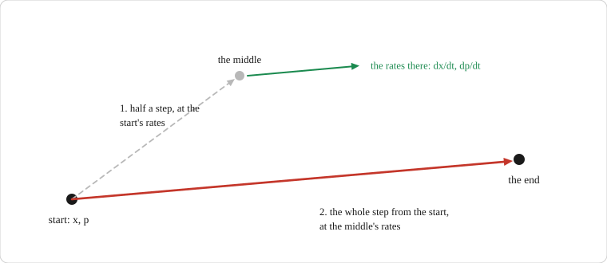

# The Simulator

The simulator moves particles and light through flowing space. This page describes how the code is built: the
classes at its core, the step that moves a particle, and how a study puts them together. The code quoted here is
shortened from `engine/`.

## The core classes

![Two families of classes. Left, the flow model in engine/flow.py: Body and Particle; Calculator, which gives the flow u; NewtonianCalculator, SpecialFlowCalculator (the flow model, dx/dt = u + w, the momentum step) and GeodesicCalculator are kinds of Calculator, and KerrFlowCalculator, for a rotating hole, is a kind of SpecialFlowCalculator. Right, spacetimes in engine/metric.py and carried.py: Spacetime gives the lapse, the flow and the curved space; FlowSpacetime, PostNewtonian, CarriedSpacetime and FreeFallTurning are kinds of Spacetime. FlowSpacetime holds a flow calculator and uses its flow. MetricCalculator, a kind of Calculator, moves a particle through any Spacetime by Hamilton's equations](images/classes.svg)

There are two families. **Flow calculators** (`engine/flow.py`) are the flow model of Parts 1 and 2: flat space,
clocks slowed only by their speed through it, and a flow $\mathbf u$. **Spacetimes** (`engine/metric.py`,
`engine/carried.py`) add a lapse and a curved space, for curved space in Parts 2 and 3 and for general relativity's
own metric. A spacetime can wrap a flow calculator, using its flow, so every flow can be tried with space curved.

### Body and Particle

A `Body` is a mass and a place. It can be white (space flows out), spin, move in a straight line, or go round the
origin on a circle:

```python
class Body:
  def __init__(self, mass=MS, x=0.0, y=0.0, black=True, spin=0.0, velocity=(0.0, 0.0), circling=0.0):
    ...

  def at(self, t):
    """where the body is at time t"""
    if self.circling:
      return turn(self.pos, self.circling*t)
    return self.pos + self.velocity*t if self.moving else self.pos
```

A `Particle` is a place and three velocities, related by $\mathbf v = \mathbf u + \mathbf w$: its velocity through the
coordinates $\mathbf v$, the flow of space where it is $\mathbf u$, and its velocity through that space $\mathbf w$.
It also keeps two times, the coordinate time `t` and its proper time `pt`.

```python
class Particle:
  def __init__(self):
    self.pos = np.array([0.0, 0.0])
    self.v = np.array([0.0, 0.0])   #velocity through the coordinates
    self.u = np.array([0.0, 0.0])   #velocity of local space
    self.w = np.array([0.0, 0.0])   #velocity relative to space
    self.pt = 0.0                   #proper time
    self.t = 0.0                    #coordinate time
```

### Calculator: the flow

`Calculator` holds the bodies and gives the flow of space at a place and time. How the bodies' flows combine is set
when it is made:

| Argument | What it sets |
| --- | --- |
| `combine='squares'` | The default. The flow's speed is the escape speed from all the bodies together, $|\mathbf u|^2 = \sum 2GM/d$, and `direction` says which way it points. |
| `combine='vectors'` | Each body's own flow, added as vectors. |
| `combine='turning'` | Two bodies going round each other on circles: the potential flow, steady in the frame turning with them (`engine/turning.py`). |
| `direction` | With `'squares'`: `'g'`, along Newton's pull; `'eikonal-exact'` (the default for two bodies) or `'eikonal'` (for more), the potential flow. |
| `carried` | Moving bodies carry their space with them (`True`), or only the flow's pattern (`False`). |
| `wave` | A gravitational wave whose flow is added (`engine/waves.py` `PlaneWave`). |

The potential flow can't be written down for two or more bodies, so it is worked out once and stored. For two bodies
`engine/two_centre.py` solves it exactly. For more, `engine/eikonal.py` traces the paths of things falling from rest
far away out of each body and stores them as a table (`RayField`). Each body's region of the flow ends at a seam.

`Calculator` also runs the loop of a simulation (`steps`, `run`), finds the step size, and handles seams: a step that
would cross one is split there (`seamStep`). The particle crosses keeping its momentum along the seam, with its energy
in the seam's own frame unchanged (`crossSeam`), the rule found in [The Hollow Sphere](../part2/hollow-sphere.md).

### SpecialFlowCalculator: the flow model

`SpecialFlowCalculator` moves a particle through the flow. In flat space with $N = 1$, the paths are Hamilton's
equations on the particle's momentum per unit mass $\mathbf p = \gamma\mathbf w$ (for light, any length along
$\mathbf w$):

$$
\frac{d\mathbf x}{dt} = \mathbf u + \mathbf w, \qquad
\frac{d\mathbf p}{dt} = -\nabla(\mathbf u\cdot\mathbf p)\Big|_{\mathbf p\ \text{fixed}}, \qquad
\frac{d\tau}{dt} = \sqrt{1 - w^2/c^2}
$$

The particle is carried by the space at $\mathbf u$ and moves through it at $\mathbf w$; the momentum changes as the
flow changes from place to place. These are the true paths of the flow's metric whether the flow has swirl or not.

### The step



Each step is the midpoint rule: the rates at the start take the particle half a step on, and the rates at that middle
take the whole step from the start. The error over a run falls as the square of the step.

```python
def moveMomentum(self, p, dt):
  q, light = momentum(p)                                   #p = gamma w (light: w)
  speed = (lambda q: C*q/length(q)) if light else (lambda q: C*q/math.sqrt(C*C + q @ q))
  side = self.sideOf(p)                                    #which side of any seam
  x, t = p.pos, p.t
  middle, end = t + dt/2, t + dt
  xm = x + (p.u + p.w)*dt/2                                #half a step, at the start's rates
  qm = q + self.flowForce(x, t, q, side)*dt/2
  vm = self.flow(xm, side, middle) + speed(qm)
  q = q + self.flowForce(xm, middle, qm, side)*dt          #the whole step, at the middle's rates
  p.pos = x + vm*dt
  p.w = speed(q)
  p.u = self.flow(p.pos, side, end)
  p.v = p.w + p.u
  p.t = end
  if not light:
    p.pt += dt*C/math.sqrt(C*C + qm @ qm)                  #proper time: 1/gamma at the middle
```

`flowForce` is $-\nabla(\mathbf u\cdot\mathbf p)$ by centred differences, a hundred-thousandth of the distance to the
nearest body across. Two earlier steps are kept for comparison (`order=1`, `order=2` with `step='velocity'`). They
take $d\mathbf w/dt = -(\mathbf w\cdot\nabla)\mathbf u$ instead, which is the same only where the flow has no swirl.

`KerrFlowCalculator` (`engine/kerr.py`) is the flow model for a rotating hole: the river model, flowing straight in,
plus the twist that turns things with the hole. `GeodesicCalculator` (`engine/geodesic.py`) takes the same Hamilton's
equations by fourth-order steps, as a check on the model's own step.

### Spacetime: a lapse, a flow and a curved space

Curved space, and general relativity itself, need more than a flow. Any spacetime can be written in the 3+1 form
(see [Deriving Curved Space](../part2/deriving-curved-space.md)):

$$
ds^2 = -N^2c^2\,dt^2 + \gamma_{ij}\,(dx^i - u^i\,dt)(dx^j - u^j\,dt)
$$

A `Spacetime` gives the three parts. Each is kept as its difference from flat, unflowing space, so that nothing is lost
in rounding against $c^2$:

```python
class Spacetime:
  static = True      #nothing changes with t: the energy is kept
  centre = None      #a point it looks the same turned about: angular momentum about it is kept
  omega = None       #steady in a frame turning at omega: the Jacobi constant is kept

  def lapseOffset(self, x, t):
    """N - 1"""
    return 0.0

  def flow(self, x, t, region=None):
    """u"""
    return ZERO

  def space(self, x, t, region=None):
    """gamma - delta (a 2 x 2 array), or None for flat space"""
    return None
```

The spacetimes in use:

| Class | What it is |
| --- | --- |
| `FlowSpacetime(calc, ...)` | Any flow calculator's flow, with a lapse and a curved space added. With nothing added, it is the flow model itself. |
| `PostNewtonian(bodies)` | General relativity's metric to the first order beyond Newton, for bodies on given paths: the reference the multi-body models are measured against. |
| `IsotropicSchwarzschild(body)` | One body in general relativity's isotropic coordinates: a check of the engine against the flow model. |
| `WaveSpacetime(wave, form)` | A plane gravitational wave, as a flow with space curved by it, or in general relativity's usual form. |
| `CarriedSpacetime(bodies, ...)` | Each body's flow carried at its velocity (`engine/carried.py`). |
| `FreeFallTurning(bodies, ...)` | General relativity's first post-Newtonian metric in the time of the one-potential flow (`engine/carried.py`). |

### MetricCalculator: moving through any spacetime

`MetricCalculator(spacetime)` moves particles through any `Spacetime`, by Hamilton's equations with the energy

$$
H = N c\sqrt{c^2 + |\mathbf p|^2} + \mathbf u\cdot\mathbf p, \qquad |\mathbf p|^2 = \gamma^{ij}p_ip_j
$$

(for light, $Nc|\mathbf p| + \mathbf u\cdot\mathbf p$). The particle moves at $d\mathbf x/dt = \partial H/\partial\mathbf p$
and its momentum changes at $d\mathbf p/dt = -\partial H/\partial\mathbf x$, by the same midpoint step. With $N = 1$
and flat space this is the flow model's step. $\partial H/\partial\mathbf x$ is taken by fourth-order centred
differences, a thousandth of the distance to the nearest body across, so that the relativistic part isn't lost in
rounding.

```python
def step(self, p, dt):
  S, side, light = self.spacetime, self.sideOf(p), p.light
  x, q, t = p.pos, p.q, p.t
  middle = t + dt/2
  xm = x + S.velocity(x, q, t, light, side)*dt/2                         #dH/dp at the start
  qm = q + S.force(x, q, t, light, side, self.nearestScale(x, t))*dt/2   #-dH/dx at the start
  vm = S.velocity(xm, qm, middle, light, side)
  p.q = q + S.force(xm, qm, middle, light, side, self.nearestScale(xm, middle))*dt
  if not light:
    p.pt += dt*S.rate(xm, qm, middle, side)                              #N c / sqrt(c^2 + |p|^2)
  p.pos = x + vm*dt
  p.t = t + dt
```

## Using them

A run makes bodies, a calculator and a particle, and steps it. Light passing the Sun at one solar radius in the flow
model:

```python
import numpy as np
from engine.flow import Body, Particle, SpecialFlowCalculator
from engine.constants import MS, AU, C

calc = SpecialFlowCalculator([Body(MS)])          #one solar mass at the origin
p = Particle()
p.pos = np.array([-10*AU, 7e8])                   #10 AU before the Sun, one solar radius from the line through it
calc.initPW(p, np.array([C, 0.0]))                #light: speed c through space
while p.pos[0] < 10*AU:
  calc.move(p, calc.stepSize(p, 0.01, 1000.0))    #each step 1% of the distance to the Sun, at most 1000 s
print(np.degrees(np.arctan2(-p.w[1], p.w[0]))*3600, 'arcseconds')   #1.741: GR's 1.75 at this distance
```

The same with space curved across the flow, for the Sun and a Jupiter-mass body, uses a spacetime instead:

```python
from engine.metric import MetricCalculator, FlowSpacetime

flow = SpecialFlowCalculator([Body(MS), Body(MS/1000, 5*AU)])   #the potential flow round both
calc = MetricCalculator(FlowSpacetime(flow, transverse='flow'))  #space stretched across it by u^2/c^2
```

A particle can start in three ways: `initPV(p, v)` at a velocity through the coordinates, `initPW(p, w)` at a
velocity through space (light when $|\mathbf w| = c$), or `initPFreefall(p)`, moving with the space.

For whole runs, `engine/run.py`'s `simulate(calc, p, config, log, ends)` steps until the first of its end
conditions, counts orbits as they happen, and writes the csv and log through `engine/logger.py`'s `Log`:

| End condition | Stops when |
| --- | --- |
| `('time', s)` | the coordinate time reaches `s` |
| `('properTime', s)` | the particle's proper time reaches `s` |
| `('min', m)` | it is closer than `m` to any body |
| `('max', m)` | it is farther than `m` from every body |
| `('orbits', n)` | it has made `n` whole orbits |

## Checking the code

Three kinds of check keep the engine honest:

- **Exact results.** One body has general relativity's exact answers (`engine/exact.py`): light's bending and delay,
  orbits' precession. The four tests of Part 1 are run against them.
- **General relativity through the same code.** `PostNewtonian` and `IsotropicSchwarzschild` run through
  `MetricCalculator` exactly as the models do. Run through a study's whole pipeline, they give the method's floor:
  what is left when the model is general relativity.
- **Step size.** The main results are run at two steps and taken to zero step. Their difference is the step's error,
  which should fall as the square of the step.

The regression tests (`./run_regression.sh`) check the engine against exact results and earlier runs in about 20
seconds.
