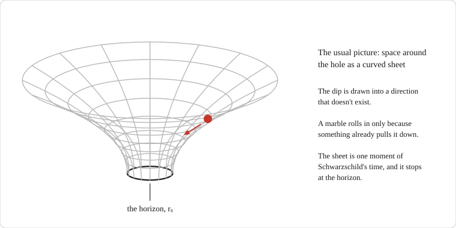

# Black Holes

So far we have looked at bodies in the solar system: the Sun, the Earth, Mercury and Venus. But in the model every
one of them is a black hole. A body is a point that space flows into at the escape speed,

$$
u = \sqrt{\frac{2GM}{r}}
$$

and nothing in the model says what is inside the Sun. That makes no difference outside it. The flow reaches the speed
of light only at the Schwarzschild radius, $r_s = 2GM/c^2$, which for the Sun is 2.95 km, deep inside it. The solar
system tests all happened far outside that radius, where the flow around a black hole and the flow around a star are
the same. Where [the four tests](tests/index.md) went closer, down to 7 Schwarzschild radii, they swapped the Sun
for a black hole of the same mass, and the flow agreed with general relativity there too.

Close in, black holes are where general relativity is hardest to picture. The usual approach uses coordinate
systems: Schwarzschild's, Eddington–Finkelstein's, Kruskal–Szekeres's and others, each suited to some questions and
misleading for others. Spatial flow gives one picture instead. Space falls inward everywhere, faster closer in. At
the Schwarzschild radius it falls at the speed of light, and inside that radius it falls faster still. Anything moving
through space is limited to $c$ *relative to the space it is in*, and that rule alone describes the black hole: what
the horizon is, why nothing comes back out, and how the same fall looks so different to different observers.

## Two pictures of a black hole

General relativity's usual picture draws the space around a black hole as a curved sheet, a funnel narrowing down to
the horizon:

The drawing is accurate about one thing: the distances in space around the hole, at one moment of Schwarzschild's
time (the time of an observer holding still far away). Near the horizon, two circles around the hole are further apart,
measured outward, than their circumferences suggest, and the funnel's slope shows by how much. But the picture
misleads in several ways:

- **The depth isn't real.** The funnel dips into a direction that isn't there. Only distances measured along the sheet
  mean anything.
- **It explains gravity with gravity.** The picture is usually read as a marble rolling into a dip in a rubber sheet,
  but the marble rolls only because the Earth's gravity is already pulling it down. And the sheet shows only space,
  while most of what makes things fall, away from a black hole, comes from time.
- **It depends on what "one moment" means.** The sheet stops at the horizon, as if there were nothing inside. Slice the
  same spacetime at one moment of a different time, the flow's, and space comes out completely flat: there is no
  funnel at all.

That last point gives the flow model its picture. Space is flat, but it is moving, falling into the hole everywhere,
faster closer in:

Space falls in at $u = c\sqrt{r_s/r}$: half the speed of light at $4\,r_s$, $c$ at the horizon, and faster than $c$
inside it. Light moves at $c$ through the space it is in, so light sent outward, seen from outside, moves out at
$c - u$. Far out it escapes easily. Closer in it gains ground more and more slowly. At the horizon it holds still, and
inside it is carried in. That is the whole of the black hole.

## A map of falling space

To see what happens near a black hole, draw a spacetime diagram: distance from the hole across, time up. Mark the
paths of bits of space falling in from far away. A clock placed on one of these lines, at rest in its space, simply
follows it. Then add light cones: the two directions light can go from each point, outward and inward, at $c$ through
the space there.

The left panel uses Schwarzschild's time, the time of an observer holding still far away and the usual way of drawing
a black hole. The light cones narrow as they approach the horizon and close up at it, and the falling observer (blue)
takes forever to get there. It looks as if the horizon is a place where time stops.

The right panel shows the same lines in the flow's time: the time kept by a clock at rest far away, and by any
clock falling in with the space from far away (clocks 1 and 2 of [The Four Clocks](mechanics/four-clocks.md); general relativity's
Gullstrand–Painlevé time). The picture is simpler. Everything is carried inward
with the space. Each light cone is the same cone, tipped inward by the flow, the way a boat's possible paths are
tipped downstream:

- Far out, space falls slowly, and light goes out and in at nearly $c$.
- At $r = 1.7\,r_s$ space falls at $0.77c$. Light sent outward still gains on the hole, but slowly: it moves at only
  $0.23c$ relative to someone holding still.
- At the horizon space falls at exactly $c$, and light sent outward holds still. The outward edge of the cone is
  vertical.
- Inside, space falls faster than $c$, and even light sent outward is carried inward. Every direction leads to the
  centre.

The falling observer crosses the horizon without noticing anything there and reaches the centre a short time later.
Nothing special happens at the horizon. It is simply where the flow reaches the speed at which light can no longer
make headway against it. None of this breaks special relativity: the speed limit is local, light always passes the
observer at $c$, and distant regions can move at more than $c$ relative to each other, just as distant galaxies
recede faster than light.

## Falling in

The simulations use a hole of 4 million solar masses, about the size of Sagittarius A\* at the centre of our galaxy.
Its Schwarzschild radius is $1.18\times10^{10}$ m, about 17 times the Sun's radius, and light takes $r_s/c = 39.4$ s
to cross it.

An observer at $20\,r_s$ holds still against the flow and stays there. A traveller falls in from rest far away,
moving with the space, so its speed relative to space is zero all the way down. The traveller passes the observer at
$t = 0$, and they set their clocks together. On the way in, the traveller sends a light signal straight back out
every 4 minutes by its own clock, and a few more in its last moments.

<iframe src="../../viewer/index.html?player&run=../runs/blackHoles/blackHoles_fall.full.json" width="100%" height="480" loading="lazy" title="Falling into a black hole"></iframe>

*Distance from the hole across, time up, as in the diagram above. Blue: the traveller. Orange: its signals, climbing
back out to the observer at $20\,r_s$. Purple: signals sent from inside the horizon. The solid line at $x = 0$ is the
hole, and the dotted lines either side are its horizon.*
[Open full screen](../../viewer/index.html?run=../runs/blackHoles/blackHoles_fall.full.json){ target=_blank }

For the traveller, the trip is uneventful. It reaches the horizon after **2324.0 s** (38.7 minutes) on its own clock,
and the centre **26.3 s** later. With w = 0 throughout, its clock keeps the flow's time exactly. The observer sees
something quite different:

| Signal sent (traveller's clock, s) | Sent from ($r_s$) | Arrives at $20\,r_s$ (s) | Exact GR (s) | Gap since the last (s) |
| --- | --- | --- | --- | --- |
| 240 | 18.61 | 310.72 | 310.72 | |
| 480 | 17.17 | 625.03 | 625.03 | 314.3 |
| 720 | 15.67 | 943.67 | 943.67 | 318.6 |
| 960 | 14.09 | 1267.67 | 1267.67 | 324.0 |
| 1200 | 12.42 | 1598.58 | 1598.58 | 330.9 |
| 1440 | 10.63 | 1938.87 | 1938.87 | 340.3 |
| 1680 | 8.67 | 2292.98 | 2292.98 | 354.1 |
| 1920 | 6.45 | 2670.62 | 2670.62 | 377.6 |
| 2160 | 3.74 | 3104.25 | 3104.25 | 433.6 |
| 2276.0 | 2 | 3394.12 | 3394.12 | |
| 2302.0 | 1.5 | 3503.01 | 3503.01 | |
| 2315.8 | 1.2 | 3606.27 | 3606.27 | |
| 2322.0 | 1.05 | 3730.61 | 3730.61 | |
| 2323.6 | 1.01 | 3861.44 | 3861.44 | |
| 2327.9 | 0.9 | never: reaches the centre at 2451.35 | 2451.35 | |
| 2341.0 | 0.5 | never: reaches the centre at 2362.00 | 2362.00 | |

*(Times are the flow's time. The observer's own clock, holding still at $20\,r_s$, runs at 0.975 of it. An observer
further out sees the same gaps, a constant time later. The simulation agrees with exact general relativity to better
than 1 part in 10⁷ of each signal's flight time, a ten-thousandth of a second.)*

The signals sent every 4 minutes arrive further and further apart, from 5.2 minutes to 7.2. Each one starts deeper in
the well, where the flow is faster, so it climbs out more slowly. The traveller takes its last 48 seconds outside
the horizon to fall from $2\,r_s$, but the signals from $2$ to $1.01\,r_s$ alone arrive over nearly 8 minutes, and
the signal sent 0.4 s before the crossing arrives 25 minutes after it was sent. A signal sent exactly at the horizon would hold still there for ever. So the
observer never sees the traveller cross. The signals arrive later and later, more and more redshifted, and slowly
fade out. Signals sent from inside the horizon go inward, carried by space falling faster than they can climb. They
reach the centre and never arrive at all.

None of this needs a special theory of the horizon. It is light at $c$ through space that is falling at nearly $c$.

### Light cones in space

The same fall in space, rather than in spacetime. At $3$, $1.5$, $1$ and $0.6\,r_s$ the traveller sends a flash of
light in twelve directions, each followed for $0.4\,r_s/c$ (15.8 s):

<iframe src="../../viewer/index.html?player&run=../runs/blackHoles/blackHoles_flashes.full.json" width="100%" height="480" loading="lazy" title="Flashes of light falling into a black hole"></iframe>

*The traveller (blue) falls along the axis. Each flash would spread in a circle in still space. Here the whole circle
is carried inward by the flow (arrows) and stretched by it. At the horizon (circle) no ray gains any ground: the one
sent straight out holds still. Inside it (purple), every ray ends closer to the centre than it began.*
[Open full screen](../../viewer/index.html?run=../runs/blackHoles/blackHoles_flashes.full.json){ target=_blank }

| Flash from ($r_s$) | Space flowing in at | Rays ending further out than they started |
| --- | --- | --- |
| 3 | $0.577c$ | 3 of 12 |
| 1.5 | $0.816c$ | 3 of 12 |
| 1 | $c$ | 1 of 12: the one sent straight out holds still |
| 0.6 | $1.291c$ | 0 of 12 |

## There and back again

Before, we looked at something falling into a black hole. Now let's imagine a probe that somehow manages to go close
to a black hole and subsequently escapes. The simulation takes it through three stages:

1. **Down.** It falls from $20\,r_s$, moving with the space as before, to $1.5625\,r_s$, where space falls in at $0.8c$.
2. **Held.** It holds itself still there, against the flow. It is now moving outward through its space at $0.8c$,
   so its clock runs at $\sqrt{1 - 0.8^2} = 0.6$. It stays for as long by its own clock as the fall took.
3. **Up.** It climbs back out ballistically, launched at the escape speed relative to where it was held: $0.8c$
   outward. Relative to space, which is falling in at $0.8c$, that is not $1.6c$. Velocities add relativistically:

    $$
    w = \frac{0.8c + 0.8c}{1 + 0.8^2} = 0.976c
    $$

    which leaves it moving out at only $0.176c$ as seen by the observer who stays put. At $0.976c$ through space its
    clock starts out running at $1/4.56$ of the flow's time, and the rate climbs back towards 1 as the probe slows
    and the flow weakens.

On the way, it sends a light signal straight back out every 5 minutes by its own clock.

<iframe src="../../viewer/index.html?player&run=../runs/blackHoles/blackHoles_probe.full.json" width="100%" height="480" loading="lazy" title="A probe close to a black hole and back"></iframe>

*The probe (blue): down, held at $1.5625\,r_s$ (where space falls in at $0.8c$), and back out. Orange: its signals
to the observer at $20\,r_s$. Solid line: the hole. Dotted: its horizon.*
[Open full screen](../../viewer/index.html?run=../runs/blackHoles/blackHoles_probe.full.json){ target=_blank }

| Stage | Probe's clock (s) | Flow's time (s) | Exact GR (s) |
| --- | --- | --- | --- |
| Down, $20 \to 1.5625\,r_s$ | 2299.0 | 2299.0 | 2299.0 |
| Held at $1.5625\,r_s$ | 2299.0 | 3831.6 | 2299.0 by its clock, 3831.6 of the flow's |
| Up, back to $20\,r_s$ | 2299.5 | 2944.9 | 2299.5 and 2944.9 |
| The whole trip | 6897.5 (1 h 55 min) | 9075.5 (2 h 31 min) | |

*(The climb ends a step past $20\,r_s$, at $20.003\,r_s$, which is why it takes 0.5 s more than the fall. Exact GR is
taken to the same point.)*

**For the probe, the trip is symmetrical.** The climb takes as long by its clock as the fall, even though it falls
with no time dilation and climbs with a lot. On the way up it moves through space at nearly $c$, so its clock runs
slow, but by the same factor the distance it covers is contracted, and the two cancel. The climb is the fall run
backwards.

**For the flow's time, it is not.** The fall takes 2299 s and the climb 2945 s. The flow's time treats in and out
differently: it is the time of clocks falling *in* with the space.

**For the observer at $20\,r_s$, it is not symmetrical either**, and this is what the signals show:

| Leg | Signals sent every (probe's clock) | Arrive every (s) |
| --- | --- | --- |
| Down | 300 s | 395 → 508, spreading out |
| Held | 300 s | 500.0 |
| Up | 300 s | 213 → 242 |

The light from the landing arrives at 3487 s, the light from the launch at 7319 s, and the probe itself is back at
9075 s. So the observer *sees* the descent take 3487 s, the stay 3832 s, and the climb only 1756 s. The descent is
stretched out and the climb compressed, by the same Doppler shift as anything moving away and then coming back,
added to the gravitational redshift. The held stage is the simplest: signals sent every 300 s arrive every 500 s, the
probe's clock rate of 0.6 exactly. That is the [gravitational redshift](tests/redshift.md) as a stream of pulses.

You might expect the distant observer to see the two legs as mirror images. There is a sense in which
they are. Schwarzschild's time, the time an observer far away would assign to each event after allowing for the light
travel time, differs from the flow's time by an amount that depends only on distance. In Schwarzschild's time the
fall and the climb take **2621.7 s each**, exactly. Which way of setting distant clocks shows the symmetry is a choice.
What arrives when is not, and the simulation agrees with exact general relativity on every arrival to a
ten-thousandth of a second.

## The same results, a different picture

General relativity and the flow model agree on every result on this page: the traveller's clock at the horizon, the
probe's clock on each leg, the time every signal arrives. They should, because the single body's flow *is* general
relativity's Schwarzschild geometry, written in Gullstrand–Painlevé coordinates. What the flow adds is a picture
where the coordinates came from:

- a horizon that is simply where space falls at $c$;
- light that can't escape because it can't make headway, not because time stops;
- an observer who falls through without noticing, because they are at rest in their space;
- and the distant observer's slowed and frozen view, which is just the light's long climb out.

*The code: studies/black_holes.py (fall, flashes and probe), checked against exact general relativity in
Gullstrand–Painlevé time; the diagrams: scripts/draw_diagrams.py.*
