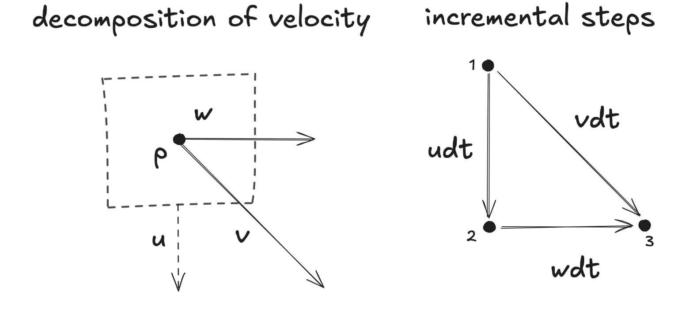
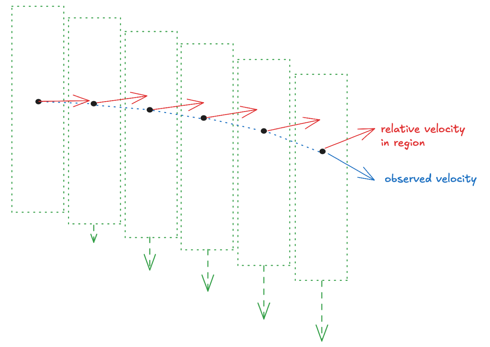

# 1.2 Mechanics of spatial flow

## 1.2.1 The basics

A particle has a location and a velocity relative to the region of space it is in.

Think of ants on a sheet of paper: some may be standing still on the paper, some moving. If we move the paper around,
the ants move with it, without it affecting their positions or velocities relative to the paper. An observer at a
distance would see each ant moving at a combination of its own velocity and the paper's.

Real ants would notice a small jolt when we start or stop moving the paper. But if space itself were accelerated,
its occupants would not be aware of it. Objects have no inertia against the motion of the very space they sit in:
space is not like the tablecloth in the party trick, where a hard enough pull leaves the vase standing on the table.

Conventions:

- $v$ — a particle's velocity, as seen by a distant observer
- $u$ — the velocity of the space the particle is in
- $w$ — the particle's velocity relative to that space

The word "flow" brings a river to mind, and any flotsam and jetsam that falls into a river is carried to its
destination. But space is empty. A river quickly speeds a floating object up to its own speed, and still water slows
and stops a moving one; space does not slow moving objects, so we would not expect steadily moving space to speed up
a stationary one.

**Postulates**

1. A particle in moving space has a velocity, seen by a distant observer, made up of the velocity of the space it is
   in plus its own velocity relative to that space: $v = u + w$.
2. Objects within a region of space move and accelerate with the space, without any change in their relative
   position or velocity, and without feeling any force.
3. Moving between regions of space flowing at different rates does not change a particle's velocity $v$.

!!! warning "Correction"
    Postulate 3 holds in the Newtonian version of the mechanics below, but not exactly in the relativistic one: once
    the change in $w$ is added relativistically, crossing between regions does change $v$ (see 1.2.3.1, where the
    simulation shows it). The original also numbers three sections 1.2.1 and two 1.2.2; they are renumbered here.

## 1.2.2 Approach

To investigate the hypothesis we need a way of modelling how space flows and how that affects particles in it. At
this stage we just want to kick the tyres, so instead of starting from a full mathematical theory we:

- consider the simplest problem: a non-rotating, spherically symmetric massive body
- take test particles of negligible or zero mass
- let no other forces act on them, so they follow ballistic paths (except that we may hold a particle stationary,
  like an object on the surface of a planet)
- describe how space and the particles in it move with simple equations, first Newtonian, then with special
  relativity
- program those equations as a simulation, to show the behaviour

## 1.2.3 The velocity of space

Take the simplest case: a non-rotating, spherically symmetric body. It is not unreasonable to assume that space
follows the path of test particles falling from (near) infinity. Then the space at distance $r$ from the body has a
velocity equal to the classical escape velocity, towards the body (along the unit vector $\hat n$ pointing at it). We
call this the gravitational velocity:

$$
\mathbf u_g = v_e\,\hat n = \sqrt{\frac{2GM}{r}}\;\hat n
$$

- It is a true velocity (unlike the classical escape velocity, which is a speed).
- It always points directly at the body.
- Space only ever flows towards the body: unlike water down a drain, it does not spiral round it.

!!! info "Since this was written"
    For a spinning body space does turn as it falls: in the river model of a rotating (Kerr) black hole the river
    flows straight in but also *twists*, and that twist is what drags frames round the hole. The simulation now
    includes it (`engine/kerr.py`) and matches exact Kerr results for light bending and orbits in the equatorial
    plane.

## 1.2.4 The Newtonian limit

First we look at the mechanics of flowing space using Newtonian mechanics alone. If the approach is valid, the
results should be indistinguishable from ordinary gravity in the Newtonian limit. The approach may seem overly
complicated for the Newtonian case, but it is the basis for adding special relativity later.

Take a particle $p$ at location 1, a distance $r_1$ from the body, with apparent velocity $\mathbf v$ as seen by a
distant observer. It is in space flowing at $\mathbf u$, and has velocity $\mathbf w$ relative to that space:

$$
\mathbf v = \mathbf u + \mathbf w, \qquad \frac{d\mathbf v}{dt} = \frac{d\mathbf u}{dt} + \frac{d\mathbf w}{dt}
$$

We know the gravitational velocity everywhere, so given the apparent velocity we can work out the local one, and the
other way round. Over a small time $dt$ the particle moves by $\mathbf v\,dt$ — or by two separate steps,
$\mathbf u\,dt$ and then $\mathbf w\,dt$:

That gives three locations: 1, the start; 2, after the space has fallen $\mathbf u\,dt$; and 3, after the particle
has moved through the space by $\mathbf w\,dt$. With only gravity acting, the procedure for each step $dt$ is:

1. For a particle at location 1 with local velocity $\mathbf w$, find the gravitational velocity $\mathbf u_1$.
2. Move the particle, with the space, by $\mathbf u_1\,dt$ to location 2.
3. Find the gravitational velocity $\mathbf u_2$ there.
4. Move the particle by its local velocity, $\mathbf w\,dt$, to location 3.
5. Find the gravitational velocity $\mathbf u_3$ there.
6. Having moved from 2 to 3 the particle is in a new frame of reference, so its relative velocity changes:
   $\mathbf w \Rightarrow \mathbf w + (\mathbf u_2 - \mathbf u_3)$.
7. Repeat.

At any time the apparent velocity and acceleration follow from $\mathbf v = \mathbf u + \mathbf w$.

!!! info "Since this was written"
    As $dt \to 0$ the procedure is

    $$
    \frac{d\mathbf x}{dt} = \mathbf w + \mathbf u, \qquad \frac{d\mathbf w}{dt} = -(\mathbf w\cdot\nabla)\,\mathbf u
    $$

    The simulation now takes the metric's own form of it, on the momentum $\mathbf p = \gamma\mathbf w$:
    $d\mathbf x/dt = \mathbf u + \mathbf w$, $d\mathbf p/dt = -\nabla(\mathbf u\cdot\mathbf p)$, second order
    by the midpoint rule, with steps that shrink close to the body. Round one body the two are the same; the momentum
    form stays second order close to a hole, and is right where the flow has curl (below).

!!! warning "Correction"
    The original's step 7 writes the change as $\mathbf u_3 - \mathbf u_2$. A particle that has moved into
    faster-flowing space has to slow relative to it to keep the same $\mathbf v$, so the change is
    $\mathbf u_2 - \mathbf u_3$ — the form the simulation uses (`engine/flow.py`).

### Particles in still space

Where space is not flowing, $\mathbf u_1 = \mathbf u_2 = \mathbf u_3 = 0$: the particle stays at rest or keeps moving
at a constant velocity, exactly as Newton's first law says.

### Stationary particles in accelerating space

A particle at rest in a region of accelerating space has $\mathbf w = 0$. The space carries it to location 2, where
space is moving faster; its local velocity does not change — it stays "stationary" — but a distant observer sees it
carried along, and since the space moves as Newton's law of gravity says, so does the particle. The one difference
from Newtonian gravity is that the particle's mass appears nowhere: even a massless particle at rest would be moved.
Massless particles shouldn't be at rest, though; we need special relativity for those.

### Particles moving between regions of space

Put gravity aside: imagine two regions of space flowing at different speeds. A particle passing from one to the
other should not change its path as a distant observer sees it — space has no friction to speed it up or slow it
down. If $\mathbf v$ stays constant while $\mathbf u$ changes, $\mathbf w$ must change: it gains a component that
cancels the change in the flow. That is step 6.

### An example: Newton's apple

An apple hangs 11 m up a tree. It falls 10 m and lands on the head of an unsuspecting Newton. With Newton's equations
this is easy; with flowing space it is a little more involved. At the apple's height space is falling towards the
ground at about 11 km/s, so for the apple to look stationary it must be moving *upwards* through space at the same
speed — the branch is pushing it against the flow. Once it lets go, the apple falls:

- $v = 0$ — the apple starts at rest, as a distant observer sees it
- $u = -11185.97$ m/s — space falling at about 11 km/s
- $w = +11185.97$ m/s — the apple moving up through space, so as to stay still relative to the Earth

The simulation at different time steps:

| | dt = 1 s | 0.1 s | 0.01 s | 0.001 s | 0.0001 s |
| --- | --- | --- | --- | --- | --- |
| time to fall (s) | 3.0000 | 1.5000 | 1.4400 | 1.4280 | 1.4272 |
| distance fallen (m) | 29.4987 | 10.3123 | 10.1107 | 10.0053 | 10.0004 |
| final velocity of space (m/s) | −11185.994 | −11185.977 | −11185.977 | −11185.977 | −11185.977 |
| final local velocity of the apple (m/s) | 11156.495 | 11171.245 | 11171.836 | 11171.954 | 11171.962 |
| final velocity seen from the ground (m/s) | −29.498 | −14.732 | −14.141 | −14.023 | −14.015 |

With Newton's equations, $d = \tfrac12 g t^2 = 10$ m gives $t = \sqrt{2d/g} = 1.428$ s and $v = gt = 14.02$ m/s. With
a small enough $dt$ the flowing-space simulation agrees.

<iframe src="../../viewer/index.html?run=../runs/part1/part1_apple.full.json" width="100%" height="460" loading="lazy" title="Newton's apple"></iframe>

*The apple's height against time, in the flow model (blue) and under Newtonian gravity (orange, dashed): the two lie
on top of each other. The flow model falls 10 m in 1.4272 s, arriving at 14.015 m/s; Newtonian gravity takes
1.4271 s.* [Open full screen](../../viewer/index.html?run=../runs/part1/part1_apple.full.json){ target=_blank }

!!! warning "Correction"
    The original gives $t = \sqrt{2d/t}$; it should be $\sqrt{2d/g}$.

!!! tip "Suggestion"
    The original says a $dt$ below about 0.001 s starts to add floating point errors. The table doesn't show that:
    the results keep converging down to 0.0001 s, and the current simulation, with its second-order step, gets the
    same 1.4272 s and 14.015 m/s at that step. Worth dropping the claim, or showing where rounding takes over.

## 1.2.5 Special relativity

Now we add special relativity. The first question is where it applies. Special relativity is local: locally, the
speed limit is always the speed of light. But two separate regions of space can move relative to each other faster
than $c$, just as two distant galaxies can move apart faster than $c$. So as long as $w < c$, neither $u$ nor $v$ is
bound by special relativity.

The procedure is the same as in 1.2.4, except step 6, which now uses the relativistic velocity addition formula:

$$
\mathbf w \Rightarrow \mathbf w \oplus (\mathbf u_2 - \mathbf u_3)
$$

The other steps deal with the velocities of different regions, which by definition are not local, so they need no
relativistic formula.

### 1.2.5.1 Movement through regions of space

Back to particles moving between regions, now beyond the Newtonian limit: a photon at the speed of light, crossing
regions of space that are themselves moving at a large fraction of $c$. As it moves between regions its local
velocity changes. With Newtonian addition this exactly cancels the extra motion of the space, and the photon goes
straight. With the relativistic formula, entering the first moving region slows its local velocity slightly, and as
it crosses further regions this becomes a rotation: the photon's path curves.

This is an example of Thomas precession (Wigner rotation). It is **not** a direct effect of gravity on the particle —
none of these regions is being accelerated by gravity — but an extra effect that applies only to particles moving
at relativistic speeds.

<iframe src="../../viewer/index.html?run=../runs/part1/part1_regions.full.json" width="100%" height="480" loading="lazy" title="Light crossing regions of moving space"></iframe>

*Light crossing space that flows downwards ever faster to the right, up to 0.8c (the arrows), by the procedure above.
Dashed: the change in the flow added as plain vectors — the path stays straight, but $|w|$ grows to 1.28c. Solid:
added relativistically — $|w|$ stays at $c$ and the path curves, ending at $v = (0.75c, -0.14c)$. Dotted: the true
geodesic of this flow's spacetime — $w$ is unchanged and the light is carried down with the space, ending at
$v = (c, -0.8c)$.* [Open full screen](../../viewer/index.html?run=../runs/part1/part1_regions.full.json){ target=_blank }

!!! info "Since this was written"
    The three answers differ because this flow has *curl*: the flow's speed changes across the direction it flows
    in. For such a flow the procedure's rule, $d\mathbf w/dt = -(\mathbf w\cdot\nabla)\mathbf u$, is not the
    geodesic of the flowing-space metric $ds^2 = -c^2dt^2 + |d\mathbf x - \mathbf u\,dt|^2$; the geodesic rule acts
    on the momentum, $d\mathbf p/dt = -(\nabla\mathbf u)\cdot\mathbf p$. For the flow round a single body, which has no
    curl, the two are the same — which is why the four tests in 1.3 come out right. The difference does matter for
    flows with curl, such as a gravitational wave crossing the plane ([Gravitational waves](../waves.md)), and the
    simulation now steps on the momentum by default.

!!! tip "Suggestion"
    The Newtonian version keeps the photon's path straight only by letting its local speed exceed $c$ (to 1.28c
    here). Worth saying, since it is the reason the relativistic formula is needed.
