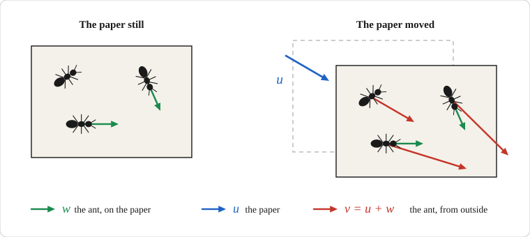
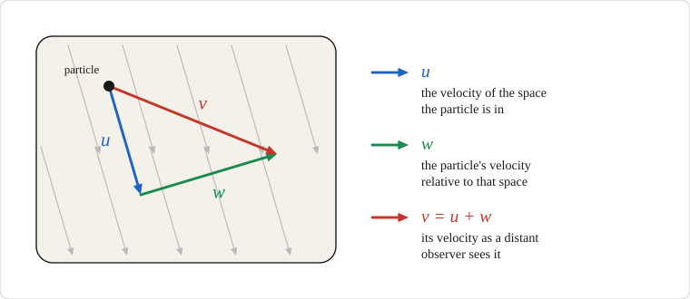

# Mechanics of Spatial Flow

## The basics

A particle has a location and a velocity relative to the region of space it is in.

Think of ants on a sheet of paper: some may be standing still on the paper, some moving. If we move the paper around,
the ants move with it, without it affecting their positions or velocities relative to the paper. An observer at a
distance would see each ant moving at a combination of its own velocity and the paper's.

Real ants would notice a small jolt when we start or stop moving the paper. But if space itself were accelerated,
its occupants would not be aware of it. Objects have no inertia against the motion of the very space they sit in:
space is not like the tablecloth in the party trick, where a hard enough pull leaves the vase standing on the table.

Conventions:

- $v$ — a particle's velocity, as seen by a distant observer
- $u$ — the velocity of the space the particle is in
- $w$ — the particle's velocity relative to that space

The word "flow" brings a river to mind, and any flotsam and jetsam that falls into a river is carried to its
destination. But space is empty. A river quickly speeds a floating object up to its own speed, and still water slows
and stops a moving one; space does not slow moving objects, so we would not expect steadily moving space to speed up
a stationary one.

**Postulates**

1. A particle in moving space has a velocity, seen by a distant observer, made up of the velocity of the space it is
   in plus its own velocity relative to that space: $v = u + w$.
2. Objects within a region of space move and accelerate with the space, without any change in their relative
   position or velocity, and without feeling any force.
3. Moving between regions of space flowing at different rates does not change a particle's velocity $v$ – in the
   [Newtonian](newtonian.md) version of the mechanics. In the [relativistic](special-relativistic.md) one the change
   in $w$ is added relativistically, and crossing between regions does turn $v$ a little.

Postulates 2 and 3 don't contradict each other. A falling particle's $v$ does change, but only because the space it is
in speeds up as it falls, and carries the particle with it (postulate 2). Crossing from one region of space into
another adds nothing to that (postulate 3).

## Approach

Part 1 starts with the simplest case: a single non-rotating, spherically symmetric body, with test particles of
negligible mass moving under no other force (though a particle may be held still, like an object on the surface of a
planet). The mechanics are described first in [Newtonian](newtonian.md) terms, then with
[special relativity](special-relativistic.md), and each is run as a simulation.

## The velocity of space

Take the simplest case: a non-rotating, spherically symmetric body. We assume that space follows the path of test
particles falling from rest far away. Then the space at distance $r$ from the body has a velocity equal to the
classical escape velocity, towards the body (along the unit vector $\hat n$ pointing at it). We call this the
gravitational velocity:

$$
\mathbf u_g = v_e\,\hat n = \sqrt{\frac{2GM}{r}}\;\hat n
$$

- It is a true velocity (unlike the classical escape velocity, which is a speed).
- It always points directly at the body: round a body that doesn't spin, space only ever flows towards it. Unlike
  water down a drain, it does not spiral round it.
- Its kinetic energy per unit mass is minus the Newtonian potential: $\tfrac12 u^2 = GM/r = -\Phi$. This is what makes
  the [Newtonian](newtonian.md#why-this-is-newtons-gravity) mechanics come out as Newton's gravity.
