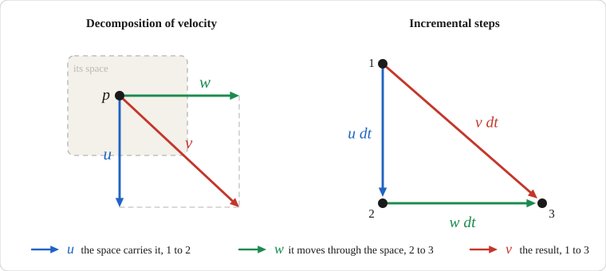

# Newtonian

!!! note "Reader's note"
    This page works through the mechanics in some detail, with vector calculus in places. The maths can be skipped
    without losing the thread: what matters is the procedure in the numbered steps, and the result that it gives
    Newton's law of gravity exactly, shown in the two examples at the end.

First we look at the mechanics of flowing space using Newtonian mechanics alone. If the approach is valid, the
results should be indistinguishable from ordinary gravity in the Newtonian limit. The approach may seem overly
complicated for the Newtonian case, but it is the basis for adding [special relativity](special-relativistic.md) later.

## The procedure

Take a particle $p$ at location 1, a distance $r_1$ from the body, with apparent velocity $\mathbf v$ as seen by a
distant observer. It is in space flowing at $\mathbf u$, and has velocity $\mathbf w$ relative to that space:

$$
\mathbf v = \mathbf u + \mathbf w, \qquad \frac{d\mathbf v}{dt} = \frac{d\mathbf u}{dt} + \frac{d\mathbf w}{dt}
$$

We know the gravitational velocity everywhere, so given the apparent velocity we can work out the local one, and the
other way round. Over a small time $dt$ the particle moves by $\mathbf v\,dt$ — or by two separate steps,
$\mathbf u\,dt$ and then $\mathbf w\,dt$:

That gives three locations: 1, the start; 2, after the space has fallen $\mathbf u\,dt$; and 3, after the particle
has moved through the space by $\mathbf w\,dt$. With only gravity acting, the procedure for each step $dt$ is:

1. For a particle at location 1 with local velocity $\mathbf w$, find the gravitational velocity $\mathbf u_1$.
2. Move the particle, with the space, by $\mathbf u_1\,dt$ to location 2.
3. Find the gravitational velocity $\mathbf u_2$ there.
4. Move the particle by its local velocity, $\mathbf w\,dt$, to location 3.
5. Find the gravitational velocity $\mathbf u_3$ there.
6. Having moved from 2 to 3 the particle is in a new frame of reference, so its relative velocity changes:
   $\mathbf w \Rightarrow \mathbf w + (\mathbf u_2 - \mathbf u_3)$. (A particle that has moved into faster-flowing
   space has to slow relative to it to keep the same $\mathbf v$.)
7. Repeat.

At any time the apparent velocity and acceleration follow from $\mathbf v = \mathbf u + \mathbf w$. As $dt \to 0$
the procedure is

$$
\frac{d\mathbf x}{dt} = \mathbf w + \mathbf u, \qquad \frac{d\mathbf w}{dt} = -(\mathbf w\cdot\nabla)\,\mathbf u
$$

## Why this is Newton's gravity

The flow round the body doesn't change with time, so the flow a particle finds itself in changes only because the
particle moves through it, at $\mathbf v = \mathbf u + \mathbf w$:

$$
\frac{d\mathbf u}{dt} = (\mathbf v\cdot\nabla)\,\mathbf u = (\mathbf u\cdot\nabla)\,\mathbf u + (\mathbf w\cdot\nabla)\,\mathbf u
$$

The first part is the particle being carried along with its space; the second is the particle crossing into other
regions of space. Step 6 takes the second part back off $\mathbf w$, so it cancels — which is postulate 3 — and what
is left is

$$
\frac{d\mathbf v}{dt} = (\mathbf u\cdot\nabla)\,\mathbf u
$$

the acceleration of the space itself. For any flow, $(\mathbf u\cdot\nabla)\mathbf u = \nabla(\tfrac12 u^2) -
\mathbf u\times(\nabla\times\mathbf u)$; the flow straight in has no curl, so the last term is zero, and with
$\tfrac12 u^2 = GM/r$

$$
\frac{d\mathbf v}{dt} = \nabla\!\left(\frac{GM}{r}\right) = -\frac{GM}{r^2}\,\hat{\mathbf r}
$$

That is Newton's law of gravity, exactly. And $\mathbf w$ has dropped out: every particle, whatever its velocity
through space, falls with the same acceleration as the space around it. Nor does its mass appear anywhere. This is
the equivalence principle — all bodies fall alike — and here it isn't assumed: it comes from the particle simply
being carried by its space.

## Particles in still space

Where space is not flowing, $\mathbf u_1 = \mathbf u_2 = \mathbf u_3 = 0$: the particle stays at rest or keeps moving
at a constant velocity, exactly as Newton's first law says.

## Stationary particles in accelerating space

A particle at rest in a region of accelerating space has $\mathbf w = 0$. The space carries it to location 2, where
space is moving faster; its local velocity does not change — it stays "stationary" — but a distant observer sees it
carried along, and since the space moves as Newton's law of gravity says, so does the particle. The one difference
from Newtonian gravity is that the particle's mass appears nowhere: even a massless particle at rest would be moved.
Massless particles shouldn't be at rest, though; we need special relativity for those.

## Particles moving between regions of space

Put gravity aside: imagine two regions of space flowing at different speeds. A particle passing from one to the
other should not change its path as a distant observer sees it — space has no friction to speed it up or slow it
down. If $\mathbf v$ stays constant while $\mathbf u$ changes, $\mathbf w$ must change: it gains a component that
cancels the change in the flow. That is step 6.

## An example: Newton's apple

An apple hangs 11 m up a tree. It falls 10 m and lands on the head of an unsuspecting Newton. With Newton's equations
this is easy; with flowing space it is a little more involved. At the apple's height space is falling towards the
ground at about 11 km/s, so for the apple to look stationary it must be moving *upwards* through space at the same
speed — the branch is pushing it against the flow.

Once it lets go, the apple falls:

- $v = 0$ — the apple starts at rest, as a distant observer sees it
- $u = -11185.97$ m/s — space falling at about 11 km/s
- $w = +11185.97$ m/s — the apple moving up through space, so as to stay still relative to the Earth

The procedure at different time steps, with the moment the apple has fallen 10 m placed between the last two steps:

| | dt = 1 s | 0.1 s | 0.01 s | 0.001 s | 0.0001 s |
| --- | --- | --- | --- | --- | --- |
| time to fall 10 m (s) | 2.0085 | 1.4773 | 1.4321 | 1.4276 | 1.4272 |
| final velocity of space (m/s) | −11185.977 | −11185.977 | −11185.977 | −11185.977 | −11185.977 |
| final local velocity of the apple (m/s) | 11166.228 | 11171.468 | 11171.914 | 11171.958 | 11171.962 |
| final velocity seen from the ground (m/s) | −19.749 | −14.509 | −14.063 | −14.019 | −14.015 |

Newton's gravity at the apple's height is $g = GM/r^2 = 9.820$ m/s², so $d = \tfrac12 g t^2 = 10$ m gives
$t = \sqrt{2d/g} = 1.4271$ s and $v = gt = 14.014$ m/s. With a small enough $dt$ the flowing-space procedure agrees:
the procedure is first order, so each tenfold smaller step brings it ten times closer.

<iframe src="../../../viewer/index.html?player&run=../runs/newtonianFlow/newtonian_apple.full.json" width="100%" height="460" loading="lazy" title="Newton's apple"></iframe>

*The apple's height against time, by the procedure (blue) and under Newtonian gravity (orange, dashed): the two lie
on top of each other. The procedure has it fall 10 m in 1.4272 s, arriving at 14.015 m/s; Newtonian gravity takes
1.4271 s.* [Open full screen](../../../viewer/index.html?run=../runs/newtonianFlow/newtonian_apple.full.json){ target=_blank }

## An example: an orbit

The apple falls straight down, so $\mathbf w$ and $\mathbf u$ point along the same line. The argument above says the
procedure is Newton's gravity whatever $\mathbf w$ is, so here is a case where they point different ways: an orbit of
the Earth between 7,000 km and 20,000 km from its centre. At the far end the satellite moves sideways at 3,215 m/s,
in space falling straight in at 6,313 m/s — so relative to its space it moves at 7,085 m/s, mostly outwards.

<iframe src="../../../viewer/index.html?player&run=../runs/newtonianFlow/newtonian_orbit.full.json" width="100%" height="560" loading="lazy" title="An orbit of the Earth"></iframe>

*Three times round, by the procedure (blue, its second-order form, steps of 0.5 s) and under Newtonian gravity
(orange, dashed). The closest approach stays at 7,000 km to within 5 m over the three orbits.*
[Open full screen](../../../viewer/index.html?run=../runs/newtonianFlow/newtonian_orbit.full.json){ target=_blank }

The procedure as the steps above have it is first order, and its error shows in an orbit: with steps of 0.1 s the
closest approach creeps out by 4 km an orbit, and with steps of 0.05 s by 2 km — half as much at half the step, so it
is the step, not the mechanics. Its second-order form (each step taken half way first, then the whole step at the
middle's rates) is the one used for the orbit here. (`studies/newtonian_flow.py`)
