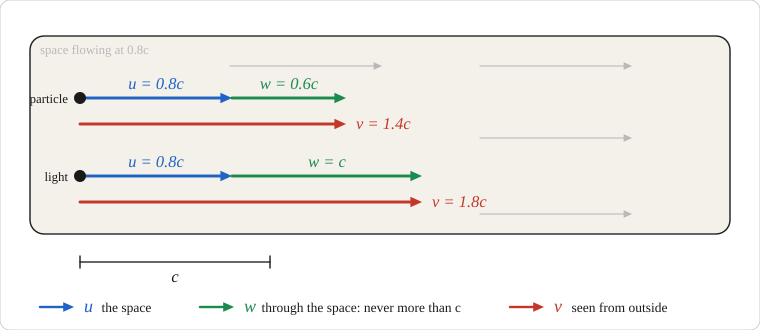
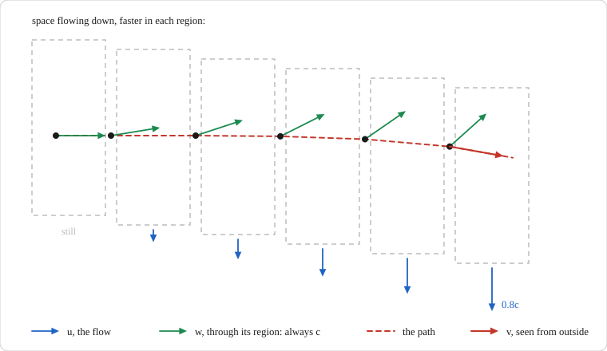

# Special Relativistic

Now we add special relativity. The first question is where it applies.

## Parallel movement through space

Special relativity is local: locally, the speed limit is always the speed of light. A particle can never move
through the space it is in faster than $c$, so $w \le c$, and only light reaches $c$.

The space itself is not bound in the same way. Two separate regions of space can move relative to each other faster
than $c$, just as two distant galaxies can move apart faster than $c$; the speed of space, $u$, is the motion of one
region of space relative to another far away, not something measured locally. And the velocity a distant observer
sees, $v = u + w$, adds a velocity through space to the velocity of that space – two velocities that are not measured
in the same place – so it is a plain sum, not the relativistic one. So as long as $w \le c$, neither $u$ nor $v$ is
bound by special relativity.

Take space flowing at $0.8c$, with a particle moving through it at $0.6c$ in the same direction. An observer riding
with the space sees the particle pass at $0.6c$; a distant observer sees it move at $v = 0.8c + 0.6c = 1.4c$. A pulse
of light in the same space moves through it at $c$, and so at $1.8c$ as the distant observer sees it:

Nothing here breaks special relativity: locally, the particle and the light are each moving through their own space
at no more than $c$, and nothing overtakes a light pulse in the same place. Space does flow this fast near a black
hole: the flow reaches $c$ at the horizon and goes faster inside it (see [Black Holes](../black-holes.md)).

## Movement through regions of space

The procedure is the same as in the [Newtonian](newtonian.md#the-procedure) case, except step 6, which now uses the
relativistic velocity addition formula:

$$
\mathbf w \Rightarrow \mathbf w \oplus (\mathbf u_2 - \mathbf u_3)
$$

Step 6 is the one local step: it changes the particle's velocity through the space it is in. The other steps deal
with the velocities of different regions, which by definition are not local, so they need no relativistic formula.

Back to particles moving between regions, now beyond the Newtonian limit: a photon at the speed of light, crossing
regions of space that are themselves moving at a large fraction of $c$. As it moves between regions its local
velocity changes. With Newtonian addition this exactly cancels the extra motion of the space, and the photon goes
straight – but only by letting its local speed exceed $c$, which is why the relativistic formula is needed. With it,
entering the first moving region slows its local velocity slightly, and as it crosses further regions this becomes a
rotation: the photon's path curves.

This is an example of Thomas precession (Wigner rotation). It is **not** a direct effect of gravity on the particle —
none of these regions is being accelerated by gravity — but an extra effect that applies only to particles moving
at relativistic speeds.

<iframe src="../../../viewer/index.html?player&run=../runs/specialFlow/special_regions.full.json" width="100%" height="480" loading="lazy" title="Light crossing regions of moving space"></iframe>

*Light crossing space that flows downwards ever faster to the right, up to 0.8c (the arrows), by the procedure above.
Dashed: the change in the flow added as plain vectors — the path stays straight, but $|w|$ grows to 1.28c. Solid:
added relativistically — $|w|$ stays at $c$ and the path curves, ending at $v = (0.75c, -0.14c)$.*
[Open full screen](../../../viewer/index.html?run=../runs/specialFlow/special_regions.full.json){ target=_blank }
