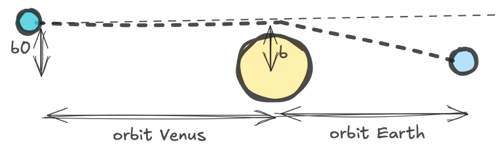

# 1.3 The four tests

In 1915 Einstein proposed three tests of general relativity: the gravitational redshift, the bending of light in a
gravitational field, and the "anomalous" precession of Mercury's perihelion. A fourth, the Shapiro time delay, was
added later. General relativity has passed all of them, and many more.

Let us apply the same tests to spatial flow. Where possible we compare it with observation, but mostly it is simpler
and more accurate to compare it with what general relativity predicts. That lets us use situations with no
measurements (such as light passing through the Sun) and ignore experimental factors. The tests rely on the
simulation of particles moving step by step through flowing space described in 1.2.

## 1.3.1 The gravitational redshift of light

General relativity predicts that light climbing out of a gravitational well is redshifted, because of time dilation:
an oscillator driving a transmitter deep in the well runs slower, so it produces waves of lower frequency. In the
hypothesis we replaced general relativity's time dilation with a special relativistic one of the same size. That is
not a full account of time dilation in flowing space, and Part 2 returns to it.

**Test — passed (sort of)**

!!! tip "Suggestion"
    This test can be passed outright. A clock holding still against space flowing in at $v_e$ ticks at
    $\sqrt{1 - r_s/r}$ (1.1). The flow doesn't change with time, so successive wave crests take the same time to
    travel from emitter to receiver, and the frequencies the two clocks measure are in the ratio of their tick rates:

    $$
    \frac{f_\text{received}}{f_\text{emitted}} = \sqrt{\frac{1 - r_s/r_\text{emitter}}{1 - r_s/r_\text{receiver}}}
    $$

    which is general relativity's gravitational redshift, exactly.

## 1.3.2 The bending of light

Newtonian gravity also predicts that starlight bends round a massive body — Cavendish and Soldner both pointed this
out around 1800 — and Einstein's first, 1911, calculation from the equivalence principle gave the same value. In
1915, completing general relativity, he found it was only half the correct value: 1.75 arcseconds for light grazing
the Sun.

The simulation can use different calculators:

- **Newtonian** — Newton's law of gravitation. The particle's mass doesn't enter, so light is bent, but $c$ is no
  limit: photons speed up and slow down.
- **Newtonian flow** — the mechanics of flowing space from 1.2.4. Should match Newtonian.
- **Special relativistic** — standard special relativity: light is bent and keeps to $c$. We expect half the
  deflection.
- **Special flow** — the mechanics of flowing space with special relativity, from 1.2.5.

The simulation sends light from 1 AU on the far side of the Sun to the Earth (2 AU in all), on a path grazing the
Sun at $7\times10^8$ m, with $dt = 0.001$ s. The general relativity approximation is $\delta\phi \approx 4GM/c^2b$,
with $b$ the closest approach.

| Calculator | Simulated deflection (rad) | Deflection (arcsec) | GR approximation (rad) |
| --- | --- | --- | --- |
| Newtonian | 4.2201 × 10⁻⁶ | 0.87 | 8.4403 × 10⁻⁶ |
| Newtonian flow | 4.2201 × 10⁻⁶ | 0.87 | 8.4403 × 10⁻⁶ |
| Special relativistic | 4.2201 × 10⁻⁶ | 0.87 | 8.4403 × 10⁻⁶ |
| Special flow | 8.4416 × 10⁻⁶ | 1.74 | 8.4403 × 10⁻⁶ |

The first three give half the observed deflection, as expected of anything other than general relativity. Special
flow gives the full deflection: 99.99% of the approximation, and 99% of the observed 1.75″.

!!! warning "Correction"
    $7\times10^8$ m is the Sun's radius, measured from its centre, not its surface, so "grazing the Sun at
    $7\times10^8$ m from the Sun's surface" should say *from its centre* — the numbers use the centre. The original
    also prints three values as "4.2201e-0.6".

Replacing the Sun with a black hole of one solar mass, we can send light closer, by factors of ten:

| Closest approach (m) | dt (s) | Original "simulated" (rad) | Original "approximation" (rad) | Exact GR (rad) |
| --- | --- | --- | --- | --- |
| 699,998,534 | 0.001 | 8.4403 × 10⁻⁶ | 8.4416 × 10⁻⁶ | 8.4404 × 10⁻⁶ |
| 69,998,542 | 0.001 | 8.4405 × 10⁻⁵ | 8.4421 × 10⁻⁵ | 8.4409 × 10⁻⁵ |
| 6,998,828 | 0.001 | 0.0008442 | 0.0008448 | 0.00084452 |
| 701,476 | 0.001 | 0.008423 | 0.008447 | 0.0084573 |
| 698,629 | 0.0001 | 0.008457 | 0.008500 | 0.0084919 |
| 68,579 | 0.00001 | 0.08615 | 0.09023 | 0.089942 |

In the original, the last row deviates more from the prediction, but since the prediction is an approximation, that
doesn't say whether the theory, the simulation or the formula is at fault.

**Test — passed**

!!! warning "Correction"
    The two middle columns look swapped. The column headed "simulated" equals the approximation $4GM/c^2r_0$ at the
    closest approach $r_0$ to the digits shown (0.086153 for the last row). Read the other way round, the simulation
    agrees with **exact** general relativity (last column, from the full deflection integral; see
    [References](../references.md)) to within 0.12% at 238 Schwarzschild radii and 0.3% at 24 — while the
    weak-field approximation is 4% off at 24. The last row's deviation is the approximation failing, not the theory.

!!! info "Since this was written"
    The special flow result's last 0.015% (8.4416 against 8.4404 × 10⁻⁶) is not an error either. Light started off
    the axis where space is flowing in at $u$ has general relativity's impact parameter $b/(1 + u/c)$, not $b$, and at
    1 AU $u/c \approx 1.4\times10^{-4}$. Allowing for that, the current simulation matches exact general relativity to
    parts in $10^7$, from 1 to 1000 AU (`studies/gr_comparison.py`).

<iframe src="../../viewer/index.html?run=../runs/part1/part1_bending.full.json" width="100%" height="520" loading="lazy" title="Light bending round a black hole"></iframe>

*Light passing a black hole of one solar mass at 4, 6, 10, 20 and 30 Schwarzschild radii, in the flow model (solid)
and under Newtonian gravity starting at $c$ (dashed); the arrows are the flow of space. Close to the hole the flow
model bends light several times as much — 57° against 14° at 4 Schwarzschild radii — and further out the ratio falls
towards the factor of two in the table (2.8 at 30 Schwarzschild radii, from 150 out on either side).* [Open full screen](../../viewer/index.html?run=../runs/part1/part1_bending.full.json){ target=_blank }

## 1.3.3 The precession of Mercury

In Newtonian gravity an isolated planet traces a fixed ellipse round the Sun, its closest point (perihelion) staying
put. In reality the other planets, and to a much lesser degree the Sun's oblateness, make the perihelia precess
slowly round the Sun. Mercury's precesses faster than these effects explain: Le Verrier found the discrepancy in
1859, about 38″ per century, later revised by Newcomb to 43″.

From here, "the precession of Mercury" means only the part Newtonian mechanics can't explain. 43″ per century is:

- 0.000208 radians per century
- 5.7 × 10⁻⁹ radians per day
- 5 × 10⁻⁷ radians per orbit

The simulation is harder than for light. Light crossing 2 AU takes about 15 minutes of simulated time; Mercury needs
at least two orbits, preferably more, of about 88 days each — at least 10,000 times as long — which forces larger time
steps, and less accuracy. Three orbits with $dt = 0.01$ s:

| | Perihelion | Precession (rad/orbit) | Aphelion | Precession (rad/orbit) |
| --- | --- | --- | --- | --- |
| dt = 0.01 s | 0.31 AU | 7.4842 × 10⁻⁷ | 0.47 AU | 7.5306 × 10⁻⁷ |

This took 10 hours to run, and the results are not especially close to the expected 5 × 10⁻⁷; $dt = 0.001$ s would
take 100 hours. Fortunately there is a formula for the precession in general relativity:

$$
\sigma = \frac{24\pi^3 a^2}{T^2c^2(1 - e^2)}
$$

with $\sigma$ the shift in radians per orbit, $a$ the semi-major axis, $T$ the orbital period and $e$ the
eccentricity. Scaling the orbit down by 10,000:

| Scaling factor | Perihelion precession | Aphelion precession | Predicted | Accuracy |
| --- | --- | --- | --- | --- |
| 10,000 | 0.0050320777 | 0.0050321204 | 0.0050216151 | 99.79% |

**Test — passed**

!!! warning "Correction"
    The formula is printed with $\pi^2$; it should be $\pi^3$ (Einstein, 1915), the same as
    $6\pi GM/c^2a(1-e^2)$. With $\pi^2$ Mercury would get 1.6 × 10⁻⁷ rad per orbit, not 5.0 × 10⁻⁷. The predicted
    value in the table is consistent with $\pi^3$. Also "Apehelion" and "Apihelion" (*aphelion*), and "miniscule"
    (*minuscule*).

!!! info "Since this was written"
    The 50% excess at $dt = 0.01$ s most likely came from the original step being first order: orbits drifted outward by an
    amount that halved with $dt$, swamping the precession. With the second-order step and steps that shrink near the
    Sun, the scaled orbits now take seconds, and their precession matches **exact** general relativity — not just the
    leading-order formula above — to 1.6 × 10⁻⁴, falling with the step size (`studies/gr_comparison.py`). About half
    of the 0.2% in the table above is the formula itself: it is only the first term of general relativity's result,
    and for Mercury's orbit scaled down 10,000 times exact general relativity gives 0.12% more.

<iframe src="../../viewer/index.html?run=../runs/part1/part1_orbit.full.json" width="100%" height="520" loading="lazy" title="A precessing orbit"></iframe>

*An orbit between about 20 and 60 Schwarzschild radii of a one-solar-mass hole, six times round. The flow model's orbit
(solid) precesses about 20° an orbit — exact general relativity gives 19.5° for those apsides — while the Newtonian
ellipse (dashed) stays closed.* [Open full screen](../../viewer/index.html?run=../runs/part1/part1_orbit.full.json){ target=_blank }

## 1.3.4 The Shapiro time delay

Irwin Shapiro proposed a further test that could be done within the solar system, sometimes called the fourth
classical test: a delay in the round-trip time of radar signals bounced off other planets. The situation is like the
bending of light, and the effect is usually put down to time dilation, like the redshift. This test gives some
interesting results.

The delay was first seen by bouncing radio waves off Mercury and Venus when they were on the far side of the Sun. We
use Venus, but compare with the approximation

$$
\Delta t = -\frac{2GM}{c^3}\ln(1 - \mathbf R\cdot\mathbf x)
$$

with $\mathbf R$ the unit vector from the observer to the source and $\mathbf x$ the unit vector from the observer to
the mass $M$. The formula lets us ignore the many other factors in the experiments — where each planet is in its
orbit, time dilation on Earth, and so on. It predicts a delay of about 100 µs for a signal from Earth to Venus that
just grazes the Sun (about 700,000 km).

The simulation gives the travel time, and we can work out the time light would take to cover the same route at $c$.
The difference: **0.0213 s**. That is nowhere near the predicted 100 µs — a major discrepancy, and the first sign the
theory may be flawed.

**Test — failed…?**

But the original experiment had no observer on Venus: the signal was echoed back to Earth, and the experiment
measured the round trip. The return journey comes out at **−0.0211 s**: the light returns *faster* than if it had
travelled at $c$. That shouldn't be surprising: the speed of light is only a local limit. Light's local velocity $w$
is always $c$, but seen from a distance it can be more or less than $c$, depending on whether it travels with or
against the flow of space. The round trip's difference, +0.0213 − 0.0211 s, is about 200 µs — the Shapiro delay
there and back.

The experiment couldn't know the exact distance between Earth and Venus, so it took readings before and after Venus
passed behind the Sun and looked at the pattern. We can do the same:

| Closest approach (solar radii) | Outbound (s) | Return (s) | Round trip (s) | GR round trip (s) | Agreement |
| --- | --- | --- | --- | --- | --- |
| 1 | 0.021349 | −0.021137 | 0.000212 | 0.000219 | 97.14% |
| 2 | 0.021336 | −0.021151 | 0.000185 | 0.000191 | 96.77% |
| 5 | 0.021318 | −0.021169 | 0.000149 | 0.000155 | 96.04% |
| 10 | 0.021304 | −0.021182 | 0.000122 | 0.000128 | 95.20% |
| 20 | 0.021290 | −0.021196 | 0.000094 | 0.000101 | 93.78% |
| 30 | 0.021282 | −0.021204 | 0.000078 | 0.000084 | 92.69% |

*(Selected rows of the original's table, from 1 to 30 solar radii.)*

This agrees well with general relativity (92–97%), but only for the round trip: each leg on its own is very
different from general relativity's prediction. Part 2 looks at this in more detail.

**Test — passed (after a slight scare)**

!!! info "Since this was written"
    The ±0.021 s on each leg is the difference between two ways of setting clocks. Spatial flow's time — the time of
    a distant observer, and of anything falling with the space — is general relativity's Gullstrand–Painlevé time.
    The prediction, and the experiment's analysis, use Schwarzschild time. The two differ by an amount that depends
    only on the distance from the Sun:

    $$
    t_\text{GP} - t_\text{S} = \frac{r_s}{c}\left[2\sqrt{\frac{r}{r_s}} + \ln\frac{\sqrt{r/r_s} - 1}{\sqrt{r/r_s} + 1}\right]
    $$

    That is 0.14024 s at the Earth and 0.11925 s at Venus: a difference of **0.0210 s**. So the outbound leg is
    0.0210 s plus its share of the Shapiro delay, and the return leg is −0.0210 s plus its share. The offsets cancel
    over any round trip, which is why the round trip agrees with general relativity, and why only round trips can
    be measured. The asymmetry is a choice of clocks, not a disagreement with general relativity.

!!! tip "Suggestion"
    The round trip agrees to 92–97%, much less closely than the bending of light or the precession. That points to
    the setup rather than the theory: for instance, how the endpoints and the closest approach are defined, and the
    one-way formula used for each leg. It would be worth rerunning with the current simulation (second-order,
    adaptive steps), measuring each leg between the same two points.

<iframe src="../../viewer/index.html?run=../runs/part1/part1_radar.full.json" width="100%" height="480" loading="lazy" title="A radar echo past a black hole"></iframe>

*A radar echo past a one-solar-mass hole: from an "Earth" 150 Schwarzschild radii on one side, passing 15 from the
hole, to a mirror 60 on the other side, and back — distance along the line against time. Out takes 2.032 ms, back
2.220 ms (2.069 ms each way in flat space). The legs differ by 189 µs, of which 176 µs is the clock offset between the
two ends; the rest comes from the light taking slightly different paths out and back. The round trip is 113 µs longer
than in flat space: the Shapiro delay, close to the weak-field estimate of about 100 µs even this near the hole.*
[Open full screen](../../viewer/index.html?run=../runs/part1/part1_radar.full.json){ target=_blank }

!!! warning "Correction"
    The original numbers this section 1.2.4; it is 1.3.4.
