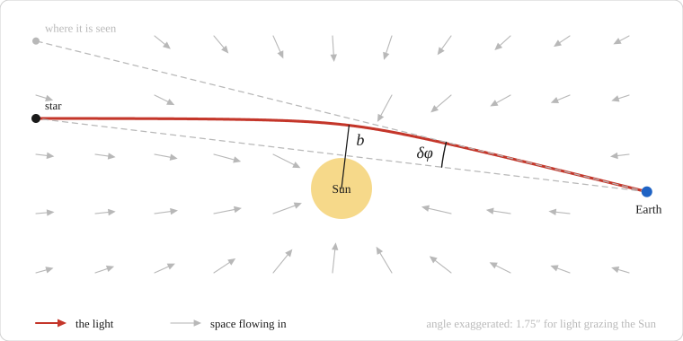

# The Bending of Light

Newtonian gravity also predicts that starlight bends round a massive body — Cavendish and Soldner both pointed this
out around 1800 — and Einstein's first, 1911, calculation from the equivalence principle gave the same value. In
1915, completing general relativity, he found it was only half the correct value: 1.75 arcseconds for light grazing
the Sun.

The simulation can use different calculators:

- **Newtonian** — Newton's law of gravitation. The particle's mass doesn't enter, so light is bent, but $c$ is no
  limit: photons speed up and slow down.
- **Newtonian flow** — the mechanics of flowing space from [Newtonian](../mechanics/newtonian.md). Should match Newtonian.
- **Special relativistic** — special relativity with Newton's gravity acting on the light's energy: light is bent
  and keeps to $c$. We expect half the deflection.
- **Special flow** — the mechanics of flowing space with special relativity, from [Special Relativistic](../mechanics/special-relativistic.md).

The simulation sends light from 10 AU on the far side of the Sun to 10 AU on the near side, on a path passing the
Sun's centre at $b = 7\times10^8$ m, one solar radius, with steps that shrink as the light nears the Sun. The general
relativity approximation is $\delta\phi \approx 4GM/c^2b$; exact general relativity is the full deflection integral
(see [References](../../appendix-c.md)).

| Calculator | Simulated deflection (rad) | Deflection (arcsec) | Exact GR (rad) |
| --- | --- | --- | --- |
| Newtonian | 4.2202 × 10⁻⁶ | 0.87 | 8.4408 × 10⁻⁶ |
| Newtonian flow | 4.2200 × 10⁻⁶ | 0.87 | 8.4408 × 10⁻⁶ |
| Special relativistic | 4.2202 × 10⁻⁶ | 0.87 | 8.4408 × 10⁻⁶ |
| Special flow | 8.4408 × 10⁻⁶ | 1.74 | 8.4408 × 10⁻⁶ |

The first three give half the observed deflection, as anything short of general relativity does: Newtonian gravity
gives 0.49997 of general relativity's, Newtonian flow 0.49995 and special relativity 0.49998. Special flow gives the full deflection, 99% of the observed 1.75″, and agrees
with exact general relativity to **1.5 parts in 10⁸**. One subtlety: light started off the axis where space is flowing
in at $u$ has general relativity's impact parameter $b/(1 + u/c)$, not $b$, so it passes a little closer than $b$ (by
4.4 parts in 10⁵, starting at 10 AU) and bends that much more than $4GM/c^2b$. The comparison is with exact general
relativity at the light's own impact parameter.

Replacing the Sun with a black hole of one solar mass, we can send light closer, by factors of ten and then to 7
Schwarzschild radii:

| Impact parameter (m) | Schwarzschild radii | Simulated (rad) | Exact GR (rad) | Simulated ÷ exact − 1 | At a third of the step |
| --- | --- | --- | --- | --- | --- |
| 700,000,000 | 236,957 | 8.4407892 × 10⁻⁶ | 8.4407891 × 10⁻⁶ | 1.5 × 10⁻⁸ | 1.8 × 10⁻⁹ |
| 70,000,000 | 23,696 | 8.4412614 × 10⁻⁵ | 8.4412613 × 10⁻⁵ | 1.5 × 10⁻⁸ | 1.6 × 10⁻⁹ |
| 7,000,000 | 2,370 | 8.4459867 × 10⁻⁴ | 8.4459866 × 10⁻⁴ | 1.7 × 10⁻⁸ | 1.8 × 10⁻⁹ |
| 700,000 | 237 | 8.4936004 × 10⁻³ | 8.4936002 × 10⁻³ | 2.1 × 10⁻⁸ | 2.3 × 10⁻⁹ |
| 70,000 | 23.7 | 0.090091235 | 0.090091232 | 3.6 × 10⁻⁸ | 3.9 × 10⁻⁹ |
| 20,679 | 7.0 | 0.36776649 | 0.36776647 | 5.9 × 10⁻⁸ | 6.6 × 10⁻⁹ |

The simulation agrees with **exact** general relativity to a few parts in 10⁸ all the way in, and ten times better
at a third of the step (the step is second order). The weak-field approximation $4GM/c^2b$, by contrast, is 22% short
at 7 Schwarzschild radii: close to the hole it is the approximation that fails, not the flow.

**Test — passed**

<iframe src="../../../viewer/index.html?player&run=../runs/part1/part1_bending.full.json" width="100%" height="520" loading="lazy" title="Light bending round a black hole"></iframe>

*Light passing a black hole of one solar mass at 4, 6, 10, 20 and 30 Schwarzschild radii, in the flow model (solid)
and under Newtonian gravity starting at $c$ (dashed); the arrows are the flow of space. Close to the hole the flow
model bends light several times as much — 57° against 14° at 4 Schwarzschild radii — and further out the ratio falls
towards the factor of two in the table (2.8 at 30 Schwarzschild radii, from 150 out on either side).* [Open full screen](../../../viewer/index.html?run=../runs/part1/part1_bending.full.json){ target=_blank }

*The code: studies/four_tests.py (bending: all four calculators for the Sun, the flow model for the hole), against
exact general relativity in engine/exact.py.*
