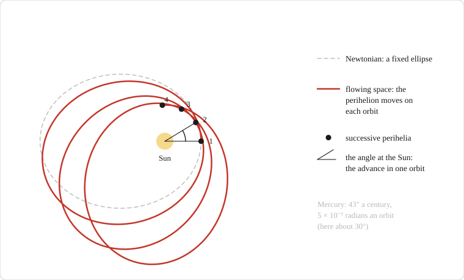

# The Precession of Mercury

In Newtonian gravity an isolated planet traces a fixed ellipse round the Sun, its closest point (perihelion) staying
put. In reality the other planets, and to a much lesser degree the Sun's oblateness, make the perihelia precess
slowly round the Sun. Mercury's precesses faster than these effects explain: Le Verrier found the discrepancy in
1859, about 38″ per century, later revised by Newcomb to 43″.

From here, "the precession of Mercury" means only the part Newtonian mechanics can't explain. 43″ per century is:

- 0.000208 radians per century
- 5.7 × 10⁻⁹ radians per day
- 5 × 10⁻⁷ radians per orbit

The simulation is harder than for light. Light crossing 2 AU takes about 15 minutes of simulated time; a century of
Mercury is 415 orbits of 88 days each, and the effect is small: each orbit the perihelion moves on by half a
millionth of a radian, about the width of a hair seen from a kilometre. The first simulation, with a first-order step
and a fixed $dt = 0.01$ s, took 10 hours for three orbits and came out 50% high: its orbits drifted outward by an
amount that halved with $dt$, swamping the precession.

The simulation now takes second-order steps that shrink near the Sun, each moving at most a set fraction of the
distance to it. Mercury's real orbit, round the Sun alone, ten orbits at each step:

| Step (fraction of the distance) | Precession (rad/orbit) | Exact GR (rad/orbit) | Simulated ÷ exact − 1 | Arcseconds a century | Run time |
| --- | --- | --- | --- | --- | --- |
| 3 × 10⁻⁴ | 4.5932 × 10⁻⁷ | 5.0208 × 10⁻⁷ | −8.5% | 39.35 | 22 s |
| 1 × 10⁻⁴ | 4.9733 × 10⁻⁷ | 5.0208 × 10⁻⁷ | −0.95% | 42.60 | 69 s |
| 3 × 10⁻⁵ | 5.0166 × 10⁻⁷ | 5.0208 × 10⁻⁷ | −0.085% | 42.97 | 4 min |
| 1 × 10⁻⁵ | 5.0203 × 10⁻⁷ | 5.0208 × 10⁻⁷ | −0.010% | 43.01 | 12 min |

Exact general relativity is the full precession integral for the orbit's own perihelion and aphelion (see
[References](../../appendix-c.md)), 43.01″ a century. Each step tenfold finer takes about a hundredth off the
difference, as a second-order step should: the difference is the step's error, not the physics. It is about the same
angle an orbit at every scale (4 × 10⁻⁸ radians at the coarsest step), which for Mercury's tiny precession is a large
part. Because the error falls as the step squared, two runs give the answer for no step at all: from the
1 × 10⁻⁴ and 3 × 10⁻⁵ rows, 5.020828 × 10⁻⁷ radians an orbit, against exact general relativity's 5.020830 × 10⁻⁷.

<iframe src="../../../viewer/index.html?player&run=../runs/mercuryCentury/mercuryCentury.full.json" width="100%" height="480" loading="lazy" title="Mercury's perihelion over a century"></iframe>

*Mercury's real orbit for a century, 417 orbits round the Sun alone, at a step of 1 × 10⁻⁴: its perihelion's advance orbit by orbit
(solid), 42.60″ by the end of the century, against exact general relativity's 43.01″ (dashed). The gap is the step's
error, under 1% here, which the table above shows shrinking to nothing as the step does. The run took 43 minutes.* [Open full screen](../../../viewer/index.html?run=../runs/mercuryCentury/mercuryCentury.full.json){ target=_blank }

Scaling the orbit down brings it closer to the Sun in Schwarzschild radii, where the precession is larger and
departs further from the formula

$$
\sigma = \frac{24\pi^3 a^2}{T^2c^2(1 - e^2)}
$$

($\sigma$ the shift in radians per orbit, $a$ the semi-major axis, $T$ the orbital period and $e$ the eccentricity),
which is only the first term of general relativity's result. Against exact general relativity, six orbits:

| Scaled down | Semi-major axis (Schwarzschild radii) | Step 1 × 10⁻³ | Step 3 × 10⁻⁴ | Step 1 × 10⁻⁴ | Exact GR (rad/orbit) |
| --- | --- | --- | --- | --- | --- |
| 10,000 | 1,960 | −9.5 × 10⁻⁵ | −8.5 × 10⁻⁶ | −9.5 × 10⁻⁷ | 0.0050280 |
| 100,000 | 196 | −9.6 × 10⁻⁶ | −8.6 × 10⁻⁷ | −9.5 × 10⁻⁸ | 0.050934 |
| 300,000 | 65 | −3.3 × 10⁻⁶ | −3.0 × 10⁻⁷ | −3.3 × 10⁻⁸ | 0.15741 |

*(Each step's simulated precession ÷ exact − 1.)* At 65 Schwarzschild radii the leading formula is 4.5% short, while
the simulation matches exact general relativity to 3 parts in 10⁸.

**Test — passed**

<iframe src="../../../viewer/index.html?player&run=../runs/strongOrbit/orbit.full.json" width="100%" height="520" loading="lazy" title="A precessing orbit"></iframe>

*An orbit between about 20 and 60 Schwarzschild radii of a one-solar-mass hole, twelve times round, each earlier orbit
fainter ("shade earlier orbits", under View). The flow model's orbit (solid) precesses about 20° an orbit – exact
general relativity gives 19.5° for those apsides – while the Newtonian ellipse (dashed) stays closed. Press Play to
watch the orbits build up.* [Open full screen](../../../viewer/index.html?run=../runs/strongOrbit/orbit.full.json){ target=_blank }

*The code: studies/four_tests.py (precession), against exact general relativity in engine/exact.py.*
