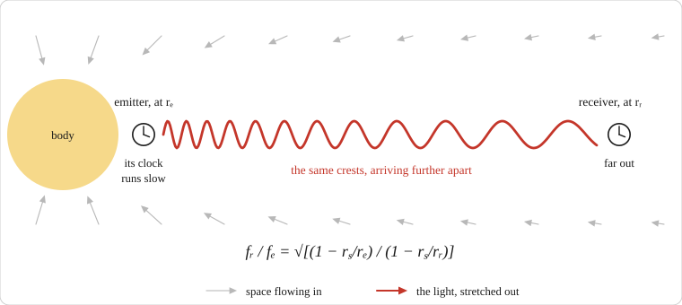

# The Gravitational Redshift of Light

General relativity predicts that light climbing out of a gravitational well is redshifted, because of time dilation:
an oscillator driving a transmitter deep in the well runs slower, so it produces waves of lower frequency.

In flowing space a clock holding still against space flowing in at $v_e$ ticks at $\sqrt{1 - r_s/r}$ (see [Hypothesis](../hypothesis.md)). The flow
doesn't change with time, so successive wave crests take the same time to travel from emitter to receiver, and the
frequencies the two clocks measure are in the ratio of their tick rates:

$$
\frac{f_\text{received}}{f_\text{emitted}} = \sqrt{\frac{1 - r_s/r_\text{emitter}}{1 - r_s/r_\text{receiver}}}
$$

which is general relativity's gravitational redshift, exactly.

**Test — passed**
