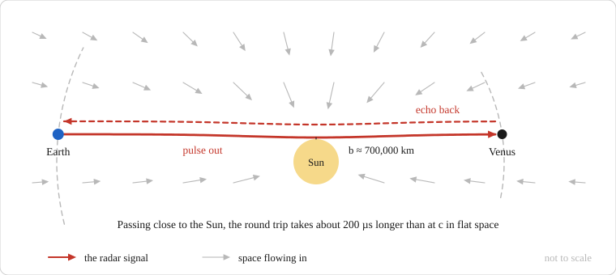

# The Shapiro Time Delay

Irwin Shapiro proposed a further test that could be done within the solar system, sometimes called the fourth
classical test: a delay in the round-trip time of radar signals bounced off other planets. The situation is like the
bending of light, and the effect is usually put down to time dilation, like the redshift. In flowing space it also
shows whose clocks keep the flow's time.

The delay was first seen by bouncing radio waves off Mercury and Venus when they were on the far side of the Sun. The
simulation sends radar from the Earth (1 AU from the Sun) past the Sun to Venus (0.723 AU) and back, the light passing
1 to 30 solar radii from the Sun's centre. Each leg is aimed so that it arrives exactly at the other planet, and the
planets are placed where exact general relativity's light ray with that closest approach would take it, so the two
can be compared directly.

The simulation gives each leg's travel time. Out to Venus takes 859.7515 s, the return 859.7935 s, at 1 solar radius:
the legs differ by **0.0420 s**, far more than the delay itself. That is the two ends' clocks (below), not the light:
the speed of light is only a local limit. Light's local velocity $w$ is always $c$, but seen from a distance it can be
more or less than $c$, depending on whether it travels with or against the flow of space. The experiment had no
observer on Venus: the signal was echoed back to Earth, and it measured the round trip, where the clocks' difference
cancels. The delay is the round trip less the time to cover the straight-line distance there and back at $c$:

| Closest approach (solar radii) | Delay, simulated (µs) | Delay, exact GR (µs) | Simulated ÷ exact − 1 | At a third of the step | Shapiro's formula (µs) |
| --- | --- | --- | --- | --- | --- |
| 1 | 212.6859 | 212.6860 | −5.2 × 10⁻⁷ | −5.4 × 10⁻⁸ | 232.4082 |
| 2 | 185.3538 | 185.3539 | −4.5 × 10⁻⁷ | −8.0 × 10⁻⁸ | 205.0641 |
| 5 | 149.2343 | 149.2346 | −2.1 × 10⁻⁶ | −4.9 × 10⁻⁷ | 168.9351 |
| 10 | 121.9112 | 121.9133 | −1.7 × 10⁻⁵ | −1.4 × 10⁻⁶ | 141.5898 |
| 20 | 94.5873 | 94.5921 | −5.1 × 10⁻⁵ | −6.5 × 10⁻⁶ | 114.1738 |
| 30 | 78.5906 | 78.6095 | −2.4 × 10⁻⁴ | −2.4 × 10⁻⁵ | 98.0322 |

*(Step: 1 × 10⁻⁴ of the distance to the Sun; the next column at a third of that.)* The simulation agrees with
**exact** general relativity (from the full integral for the light's time along its path; see
[References](../../appendix-c.md)) to 5 parts in 10⁸ for light grazing the Sun at the finer step. Further out the light
takes longer steps, and the difference grows, but it falls as the step squared: tenfold at a third of the step.

The approximation, written for the experiment as

$$
\Delta t = \frac{4GM}{c^3}\ln\frac{r_E + r_V + R}{r_E + r_V - R}
$$

with $r_E$ and $r_V$ the planets' distances from the Sun and $R$ the distance between them, gives 9–25% more than
exact general relativity here. That is not an error in either, but where distances are measured from: the formula's
$R$ belongs to coordinates whose distances from the Sun are $GM/c^2$ less than the ones used here, which adds a
constant $2r_s/c = 19.7$ µs to the delay at every closest approach. The experiment couldn't know the exact distance
between Earth and Venus either, so it took readings before and after Venus passed behind the Sun and looked at the
pattern – how the delay changes – where any constant cancels. Measured from the delay at 30 solar radii:

| Closest approach (solar radii) | Simulated (µs) | Exact GR (µs) | Shapiro's formula (µs) |
| --- | --- | --- | --- |
| 1 | 134.0783 | 134.0765 | 134.3760 |
| 2 | 106.7463 | 106.7444 | 107.0318 |
| 5 | 70.6268 | 70.6251 | 70.9028 |
| 10 | 43.3054 | 43.3038 | 43.5575 |
| 20 | 15.9838 | 15.9826 | 16.1416 |

The simulation and exact general relativity agree to a few thousandths of a microsecond; the weak-field formula is
within 0.3 µs of both, the size of its own next-order terms.

The ±0.021 s on each leg is the difference between two ways of setting clocks. Spatial flow's time – the time of a
distant observer, and of anything falling with the space – is general relativity's Gullstrand–Painlevé time. The
one-way formula, and the experiment's analysis, use Schwarzschild time. The two differ by an amount that depends only
on the distance from the Sun:

$$
t_\text{GP} - t_\text{S} = \frac{r_s}{c}\left[2\sqrt{\frac{r}{r_s}} + \ln\frac{\sqrt{r/r_s} - 1}{\sqrt{r/r_s} + 1}\right]
$$

That is 0.14024 s at the Earth and 0.11925 s at Venus: a difference of **0.0210 s**, which the light inward to Venus
gains and the light back outward loses. The offsets cancel over any round trip, which is the only thing that can be
measured.

**Test — passed**

<iframe src="../../../viewer/index.html?player&run=../runs/part1/part1_radar.full.json" width="100%" height="480" loading="lazy" title="A radar echo past a black hole"></iframe>

*A radar echo past a one-solar-mass hole: from an "Earth" 150 Schwarzschild radii on one side, passing 15 from the
hole, to a mirror 60 on the other side, and back — distance along the line against time. Out takes 2.032 ms, back
2.220 ms (2.069 ms each way in flat space). The legs differ by 189 µs, of which 176 µs is the clock offset between the
two ends; the rest comes from the light taking slightly different paths out and back. The round trip is 113 µs longer
than in flat space: the Shapiro delay, close to the weak-field estimate of about 100 µs even this near the hole.*
[Open full screen](../../../viewer/index.html?run=../runs/part1/part1_radar.full.json){ target=_blank }

*The code: studies/four_tests.py (shapiro), against exact general relativity in engine/exact.py.*
