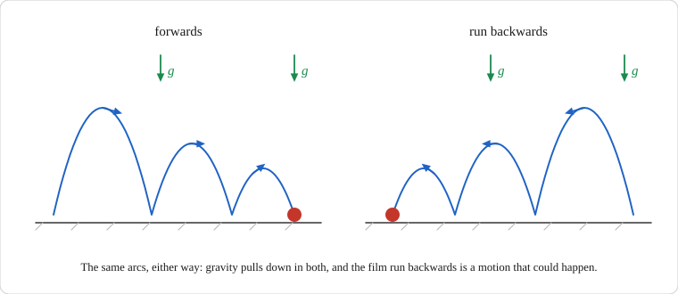
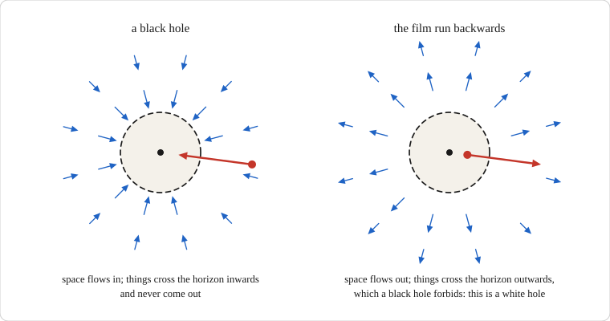

# White Holes

!!! note "Reader's note"
    This page is an aside. White holes are a curiosity of the theory, and nothing later depends on them, so it can be
    skipped without missing anything in the main discussion.

## Why white holes have to exist, in theory

The laws of physics, as far as we know them, don't care which way time runs. Film almost any motion and run the film
backwards, and what you see is also a motion the laws allow. A ball bouncing under gravity is the simplest example:

Run backwards, the bounces get higher instead of lower, which only looks odd because we have left out friction and the
energy lost at each bounce. Leave those aside and the reversed film is a perfectly good motion. In particular, gravity
still pulls *down*: the ball still slows as it rises and speeds up as it falls. Gravity is attractive whichever way the
film runs.

General relativity is the same: run any of its solutions backwards and you get another solution. So what is a black
hole, run backwards?

The film shows things coming *out* of the horizon, and a black hole can't do that: nothing that crosses its horizon
ever comes back. So the reversed film isn't a black hole at all. It is a different object, which the theory has to
allow, because its laws run both ways: a **white hole**.

## The general relativistic view

In general relativity, a white hole is the time reverse of a black hole. Nothing can enter it: its horizon can only be
crossed outward. Everything inside it must leave.

Outside the horizon, a white hole is indistinguishable from a black hole of the same mass. Schwarzschild's solution
outside the horizon is the same whichever way time runs, so a white hole attracts. A planet would orbit it exactly
as it would orbit a black hole, light passing it bends the same way, and anything let go near it falls towards it.

This is where it becomes hard to picture. Something falling towards a white hole is pulled towards it, harder and harder
the closer it gets: the force needed to hold still against the pull grows without limit near the horizon, just as for a
black hole. Yet nothing from outside can ever cross the horizon. In the white hole's own time, the falling object gets
closer and closer, pulled ever harder, and never arrives. Something is pulling it in, and something is stopping it, and
the usual picture of gravity as a force says nothing about what.

## The spatial flow view

In flowing space, a white hole is a black hole with the flow reversed. Space flows *out* of it at the escape speed,
$u = \sqrt{2GM/r}$: at the speed of light at the horizon, faster inside, and slower further out.

This picture is much easier to understand:

- **The white hole still attracts.** Space leaves the hole at the speed of light, and slows as it climbs, like a ball
  thrown upwards at exactly the escape speed. Its slowing down is an acceleration pointing back towards the hole: $g$,
  at $GM/r^2$, the same as a black hole's. Anything that isn't being pushed falls back towards the hole.
- **A falling body moves into faster and faster space.** Something falling in from far away is moving against the
  flow. To make any headway, it has to move inwards *through* space faster than the space carries it out. The closer it
  gets, the faster the space coming out to meet it, so the faster it has to move through it. As seen from far away,
  its progress slows to a crawl.
- **Its clock runs slower and slower.** This is where the [mechanics of the model](mechanics/four-clocks.md)
  come in: a clock moving through its space at $w$ runs at $\sqrt{1 - w^2/c^2}$. The faller's speed through space is
  the escape speed added to the flow's, relativistically, $w = 2u/(1 + u^2/c^2)$. Near the horizon $u$ approaches
  $c$, so $w$ approaches $c$ too, and the faller's clock runs slower and slower.

| Distance ($r_s$) | Space flows out at | The faller moves in through it at | Its clock runs at |
| --- | --- | --- | --- |
| 20 | $0.224c$ | $0.426c$ | 0.905 |
| 4 | $0.5c$ | $0.8c$ | 0.6 |
| 2 | $0.707c$ | $0.943c$ | 0.333 |
| 1.1 | $0.953c$ | $0.9989c$ | 0.048 |
| 1.01 | $0.995c$ | $0.99999c$ | 0.005 |

At the horizon itself space flows out at $c$, and nothing can move through space faster than that. The faller is in
the position of light trying to leave a black hole: it holds still, however hard it tries. It is pulled in, because
the space around it is falling back, and it is stopped, because it can't overtake the space coming out. There's no
contradiction, and no force doing two things at once.

A spacetime diagram of the same fall, drawn in each hole's own time, shows it. Into the black hole the faller moves with
the space and crosses the horizon; into the white hole it moves against it, and in the white hole's time it creeps
towards the horizon for ever:

### Light near a white hole

The same flashes as on the [Black Holes](black-holes.md) page, sent by the faller at $3$, $1.5$ and $1.1\,r_s$, each
followed for $0.4\,r_s/c$ (15.8 s):

<iframe src="../../viewer/index.html?player&state=z7dtNi9s4GAfwrzI8e5Vdvzv1rYdlt1DostcQgmPLibYaabDkpCHkuy9yZtKOZJpL8Ux4dIpiW7L9iyD6g54T7KGKCewZPSiolifoB2EaSwjDD6b9YcPr5tvfktOfm-uO12pHVdgNnIf_KSmAwC9Pr1YEnnraKahOoHby8E-td1_olooWqq7mipLx8GfR1Zz_y8RWQaX7gZ4J9FQNXI89x4HNFeskSoogjoOkXCdJkORB_jFs1N5ctGeKbTi99CegdF-z7U5f76NrsaVCm0ul-HEUKjFwTqCRXPYvX5Q-mpGgNS_UwpkAFa26dpL9huk_97Q_jo7j1eODPknDCH8kdbloCyCgJGctkOdRmdhyCqszAUU5bTQzD7Jcmm7r70DGz-OItu3l8PTyNDvWtlR8NTc1w5v-o0i0jqJ7EaGbYpFmM4jEXsQSSbyIJZJ6EUsk8yKWSO5FLJHCFimCKEItUnoRS2ThRSyRj17ktUjsrFnRizhrVtwi8USuQS_i54gt4uQa9CJOrkEv4uQa9CJOrkEv4nONLeJzjS3ic40t4nONJeJzjSPi16yvRBKfa1wRP0dsEZ9rbBGfa2wRn2tsEZ9rbBGfa2wRn2tsEZ9rbBGfaywRn2scEb9mfSWS3lGuWdR50y5mELmbOTKbyN3kmtlE7ibXzCZyN7lmNpG7yTWzidxNrplN5G5yzWwiU7kmRi0ylWtQi0zmGtwiU2tWjCLnS20UVMsgLRdRXERploZJkkVRlJM8jtIkLrIiTcM8yUgQF2WWLYosjtOwLPOySIl7aEVgUzffzI1N8RPoHX3ouDw8MKHlg_m2k5wCAc0e6Wehab-vOVQABDrJuTxc7cZXo2aM23VRBFrWdbSnoqHPv_ZEtddhxzS9VHv9aE5We_3ytFPt9Vdf75k-XqfM7y8AK4P8Xf7RvV0B2HsVebsCMPQiTvBGL-IEb_QiTvBGL-IEb_QiTvBGL-IEb_QiTvBGL-IEb-wibvBGL-LXrDcLwNCL-DlyswAMvYjPNTcLwNCL-FxzswAMvYjPNTcLwNCL-FxzswAMvYhfs94sAEMv4ufIzQIw9CJTueZdbkx4uwIw9CJTuQa3yFSuwS0ylWtwi0zlGtwiU7kGtchkrsEtMrVmxSgy60ZJOegH2f3urZLXtbW7VXJFoG4021OoIgK8PtJ-xN1CdTJ0Tc3r_tLWB6b082FaP15ajRRaDmOfce7IwxcmqLqefGkOlw827oH81PfyoH4-8rwr8jTOjKGHCoLgcTCvRaClQo07LGMCB9bqHVRxmBBQT9S8dnw-n_8H" width="100%" height="480" loading="lazy" title="Flashes of light near a black hole and a white hole"></iframe>

*Left: the black hole's flashes, as on the Black Holes page. Right: the white hole's. The grey rings are space itself,
moving at a speed chosen for the picture: falling into the black hole, and flowing out of the white hole. The faller
(blue) falls through the black hole's horizon, but only creeps in towards the white hole's. Each of the white hole's
flashes is carried outward by the flow (grey arrows), while $g$ (dark arrows) points back in. Close to the horizon,
even the ray sent straight in barely moves.*
[Open full screen](../../viewer/index.html?state=z7dtNi9s4GAfwrzI8e5Vdvzv1rYdlt1DostcQgmPLibYaabDkpCHkuy9yZtKOZJpL8Ux4dIpiW7L9iyD6g54T7KGKCewZPSiolifoB2EaSwjDD6b9YcPr5tvfktOfm-uO12pHVdgNnIf_KSmAwC9Pr1YEnnraKahOoHby8E-td1_olooWqq7mipLx8GfR1Zz_y8RWQaX7gZ4J9FQNXI89x4HNFeskSoogjoOkXCdJkORB_jFs1N5ctGeKbTi99CegdF-z7U5f76NrsaVCm0ul-HEUKjFwTqCRXPYvX5Q-mpGgNS_UwpkAFa26dpL9huk_97Q_jo7j1eODPknDCH8kdbloCyCgJGctkOdRmdhyCqszAUU5bTQzD7Jcmm7r70DGz-OItu3l8PTyNDvWtlR8NTc1w5v-o0i0jqJ7EaGbYpFmM4jEXsQSSbyIJZJ6EUsk8yKWSO5FLJHCFimCKEItUnoRS2ThRSyRj17ktUjsrFnRizhrVtwi8USuQS_i54gt4uQa9CJOrkEv4uQa9CJOrkEv4nONLeJzjS3ic40t4nONJeJzjSPi16yvRBKfa1wRP0dsEZ9rbBGfa2wRn2tsEZ9rbBGfa2wRn2tsEZ9rbBGfaywRn2scEb9mfSWS3lGuWdR50y5mELmbOTKbyN3kmtlE7ibXzCZyN7lmNpG7yTWzidxNrplN5G5yzWwiU7kmRi0ylWtQi0zmGtwiU2tWjCLnS20UVMsgLRdRXERploZJkkVRlJM8jtIkLrIiTcM8yUgQF2WWLYosjtOwLPOySIl7aEVgUzffzI1N8RPoHX3ouDw8MKHlg_m2k5wCAc0e6Wehab-vOVQABDrJuTxc7cZXo2aM23VRBFrWdbSnoqHPv_ZEtddhxzS9VHv9aE5We_3ytFPt9Vdf75k-XqfM7y8AK4P8Xf7RvV0B2HsVebsCMPQiTvBGL-IEb_QiTvBGL-IEb_QiTvBGL-IEb_QiTvBGL-IEb-wibvBGL-LXrDcLwNCL-DlyswAMvYjPNTcLwNCL-FxzswAMvYjPNTcLwNCL-FxzswAMvYhfs94sAEMv4ufIzQIw9CJTueZdbkx4uwIw9CJTuQa3yFSuwS0ylWtwi0zlGtwiU7kGtchkrsEtMrVmxSgy60ZJOegH2f3urZLXtbW7VXJFoG4021OoIgK8PtJ-xN1CdTJ0Tc3r_tLWB6b082FaP15ajRRaDmOfce7IwxcmqLqefGkOlw827oH81PfyoH4-8rwr8jTOjKGHCoLgcTCvRaClQo07LGMCB9bqHVRxmBBQT9S8dnw-n_8H){ target=_blank }

| Flash from ($r_s$) | Space flowing out at | Rays ending further out than they started |
| --- | --- | --- |
| 3 | $0.577c$ | 9 of 12 |
| 1.5 | $0.816c$ | 9 of 12 |
| 1.1 | $0.953c$ | 11 of 12 |

## Just like a black hole

Here is the surprising part. To the faller, and to an observer far away, a fall into a white hole looks *exactly* the
same as a fall into a black hole.

The simulation repeats the [Black Holes](black-holes.md) fall with the flow reversed. The traveller passes the observer
at $20\,r_s$ at $t = 0$, falling in from rest far away, and sends a light signal straight back out every 4 minutes of
its own time, and a few more near the horizon. Black hole on the left, white hole on the right:

<iframe src="../../viewer/index.html?player&state=z7ZhNj5swEIb_SjQ99GKyfAbCbQ-tWqlSq_YYRZEDk8Rdr53ahjSK8t8rQ_ajwPa23V3hE-Oxxx4eI_HqPUENeUCgZnjQkC9OoCphgwVMp1c2vlpzWtx8khwfh6sN5Xy6qTif_tRSAIGn55ZLAnuFGw35CfBXRfm13mNhIN9QrpGA3snDRy4PfyW-UbP7glsU5SV9JqBQV9w0-9gzVqEfzrwg8MJ0FYZemHhJOi10bedrptmaI-RGVXZHoyjb7h7ONFRsURi7VIqHLOSi4pxAIblUdwNtjnYnKKneYQlnAihKfV8k1ZqZDzWqY4OyWd30uJd69XtyNTGQL-BdSNOsnAEBLTkrgVz2ZmLLEZZnAho5FobZdhaLthhsS5bfVslqf9fPjpUliq_2WHtVttbiUPQYvC0kuJ5lUfy8SEKHpIskcki6SGKHpIskcUi6SGYOSRdJ6pB0kWQOSRfJ3CHpSTXfMekxcfq1z2RIwGYjZzKkYMfOZEjCzkfOZEjDvmImGU2KMntmJkMidpxMzq3vBfnCC7K572d-GEb-NCZhkgQzP4v8ILBDLwr9qe8HURzHaTQjcTMOsiDxo3k0WxJY0-LGnmXNKvjRNITlpLWr3usJipopKW4tOQKG3eJnYVDVlEMOQGAjeWN_Xd7tUg_5v10uAiXbbFChKPByyQP23WHHDLb23UPYt--envtv9l3qxa_4O3wR--51I3kR-84h6Ykfh6SnfRySnvRxSHrKxyHp2XcOSc--c0h69p1D0rfvUi_xR85kQL-OnsmAgB09kwEFO3omAxJ2pEzepi1z_0vs2zJLArQwrEbIfQKcHlE1RLeQnyypgnKq2tgcmDaXNNLbNiqkMLJqauwHw-XhCxOo7yfvwqp9MGH7u1ZKHvTjzHcmtk3ifP4D" width="100%" height="480" loading="lazy" title="Falling into a black hole and into a white hole"></iframe>

*Distance from the hole across, time up, each in its own hole's time. Blue: the traveller. Orange: its signals, back
out to the observer at $20\,r_s$. Purple (black hole only): signals from inside the horizon. Into the black hole the
traveller crosses the horizon; into the white hole it never does, but its signals arrive at the same times. The two
play on one clock, so pressing Play shows the signals reaching the observer together.*
[Open full screen](../../viewer/index.html?state=z7ZhNj5swEIb_SjQ99GKyfAbCbQ-tWqlSq_YYRZEDk8Rdr53ahjSK8t8rQ_ajwPa23V3hE-Oxxx4eI_HqPUENeUCgZnjQkC9OoCphgwVMp1c2vlpzWtx8khwfh6sN5Xy6qTif_tRSAIGn55ZLAnuFGw35CfBXRfm13mNhIN9QrpGA3snDRy4PfyW-UbP7glsU5SV9JqBQV9w0-9gzVqEfzrwg8MJ0FYZemHhJOi10bedrptmaI-RGVXZHoyjb7h7ONFRsURi7VIqHLOSi4pxAIblUdwNtjnYnKKneYQlnAihKfV8k1ZqZDzWqY4OyWd30uJd69XtyNTGQL-BdSNOsnAEBLTkrgVz2ZmLLEZZnAho5FobZdhaLthhsS5bfVslqf9fPjpUliq_2WHtVttbiUPQYvC0kuJ5lUfy8SEKHpIskcki6SGKHpIskcUi6SGYOSRdJ6pB0kWQOSRfJ3CHpSTXfMekxcfq1z2RIwGYjZzKkYMfOZEjCzkfOZEjDvmImGU2KMntmJkMidpxMzq3vBfnCC7K572d-GEb-NCZhkgQzP4v8ILBDLwr9qe8HURzHaTQjcTMOsiDxo3k0WxJY0-LGnmXNKvjRNITlpLWr3usJipopKW4tOQKG3eJnYVDVlEMOQGAjeWN_Xd7tUg_5v10uAiXbbFChKPByyQP23WHHDLb23UPYt--envtv9l3qxa_4O3wR--51I3kR-84h6Ykfh6SnfRySnvRxSHrKxyHp2XcOSc--c0h69p1D0rfvUi_xR85kQL-OnsmAgB09kwEFO3omAxJ2pEzepi1z_0vs2zJLArQwrEbIfQKcHlE1RLeQnyypgnKq2tgcmDaXNNLbNiqkMLJqauwHw-XhCxOo7yfvwqp9MGH7u1ZKHvTjzHcmtk3ifP4D){ target=_blank }

| Signal sent (traveller's clock, s) | From ($r_s$) | Sent, black hole's time (s) | Sent, white hole's time (s) | Arrives at $20\,r_s$, black hole (s) | Arrives, white hole (s) |
| --- | --- | --- | --- | --- | --- |
| 240 | 18.61 | 240 | 266.2 | 310.72 | 310.72 |
| 960 | 14.09 | 960 | 1080.4 | 1267.67 | 1267.67 |
| 1680 | 8.67 | 1680 | 1940.9 | 2292.98 | 2292.98 |
| 2160 | 3.74 | 2160 | 2614.4 | 3104.25 | 3104.25 |
| 2276.0 | 2 | 2276.0 | 2861.2 | 3394.12 | 3394.12 |
| 2315.8 | 1.2 | 2315.8 | 3055.8 | 3606.27 | 3606.27 |
| 2323.6 | 1.01 | 2323.6 | 3307.1 | 3861.44 | 3861.43 |

*(Both simulations agree with exact general relativity to within 0.02 s.)*

- **For the traveller**, nothing is different. Its clock reads the same at each distance in both. Into the black hole
  it crosses the horizon at **2324.0 s**; into the white hole, by $t = 4000$ s of the white hole's time it is
  $2\times10^{-6}\,r_s$ from the horizon, its clock reads **2324.0 s**, and it is running at less than a millionth of
  the white hole's time.
- **For the observer**, nothing is different either. Each signal arrives at the same time, to a hundredth of a
  second: further and further apart, until they fade away.

The two holes differ only in their own time, which is a choice of how to set clocks that are far apart. The black
hole's is the time kept by clocks falling in with its space; the white hole's, by clocks carried out with its space.
What the traveller's clock reads, and when each signal arrives, doesn't depend on that choice, and is the same.

*The code: studies/white_holes.py (the fall and the flashes, checked against exact general relativity in the white
hole's time) and studies/black_holes.py; the diagrams: scripts/draw_diagrams.py.*
