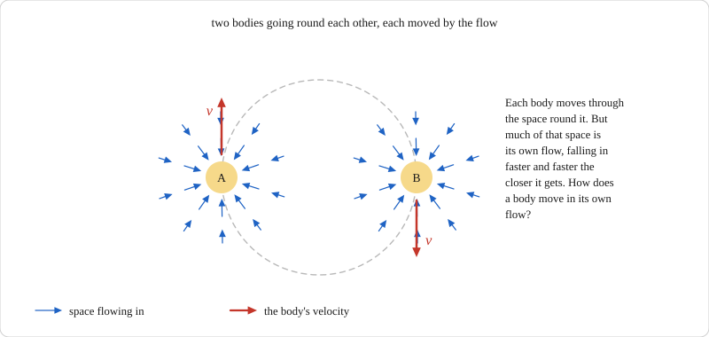

# Bodies Moved by the Flow

## Where we are

Part 3 set the bodies moving, on paths that were given: the Earth on a circle round the Sun, Jupiter on its orbit. It
found the flow they carry. [One potential](../part3/one-potential.md) for the whole plane, with space curved across
it and the small corrections that general relativity gives, is general relativity for bodies on given paths: light
past the Sun and past Jupiter, and the Moon's slow turn, all come out right.

Only the Moon moved by the flow, and the Moon is too light to matter to the others. In a real pair of stars nothing
gives the bodies their paths. Each moves by the space round it, and the paths are the answer, not the question.

## A body in its own flow

A light body is easy: it moves with the space it is in. That rule is all of Part 1. A body with a field of its own is
harder. Much of the space round it is its own flow, falling in faster and faster the closer it gets: at a point mass,
infinitely fast. "Move with the space where it is" has no answer at the body itself.

Part 4 tries two ways out:

- **[Each body in the others' flow](each-body-in-the-others-flow.md)**: leave each body's own flow out, and move it in
  the flow the other bodies make.
- **[Moving with its own space](moving-with-its-own-space.md)**: keep each body's own flow, and move the body with the
  space round it, averaged over a small sphere.

## The tests ahead

A pair of comparable masses shows what a light body can't. Each test below has a light-body limit that Part 3
already passes, and a part that grows with how alike the two masses are.

| Test | What is measured | How well |
| --- | --- | --- |
| A binary's orbit turning | how fast the closest point of the orbit moves round, for comparable masses | binary pulsars, among them the double pulsar, whose masses are nearly equal |
| The binary's centre | stays put: a pair doesn't push itself along | binary pulsars' periods; momentum conservation |
| The Nordtvedt effect | a bound pair falls towards a third body as a single body of its mass does | lunar laser ranging: the Earth and Moon falling towards the Sun, to 1 part in 10⁴ |

The binary in the simulations is made to show these effects large: two bodies of two solar masses in all, 100,000 km
apart on an orbit of eccentricity 0.3. It goes round in six and a half minutes, and its closest
point turns by about two minutes of arc each orbit. That is far faster than any real binary, but the effects measured
are the same ones, scaled up.

The next page starts with the simplest way out.
