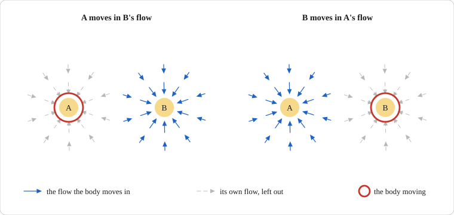

# Each Body in the Others' Flow

[One potential](../part3/one-potential.md) moves a light body, the Moon, with the space it is in. A body with a field
of its own sits at the centre of its own flow, where that flow is infinitely fast, so the same rule gives it no
answer. This page tries the simplest way round that: leave each body's own flow out.

One potential can't do that. It is one flow for the whole plane, and no part of it belongs to one body more than
another. So this page goes back to a flow built from each body's own: the flow of
[Carrying the Flow](../part3/carrying-the-flow.md), where each body carries its own one-body flow with it at its
velocity, and the others' flows are added where they reach.

## The model: leave each body's own flow out

Each body moves as a light body would in the flow the *other* bodies make, its own flow left out. For two bodies,
each moves in the other's flow, carried with it: seen from the other body, that is the one-body flow of Part 1.

This flow has a cost. Built from each body's own flow, it has no single potential, and the Moon,
moving in it round the Earth for 90 days, turns only about half as much as general relativity's: $k = +0.47$, as for
the turning flow. Here it is tried anyway, because it is the simplest way to leave a body's own flow out, and the
tests of this part are a pair of comparable masses.

## The test: a binary's orbit turning

General relativity's orbit of two bodies doesn't close: its closest point, the periastron, moves round a little each
orbit. To the first order beyond Newton the rate is the same for any two masses with the same total:
$6\pi\,(GMn)^{2/3}/(c^2(1-e^2))$ radians each orbit, with $M$ the total mass, $n$ the orbit's angular frequency and
$e$ its eccentricity. Binary pulsars measure it precisely. In the double pulsar, whose two masses are nearly equal,
it agrees with general relativity together with the pulsar's other timing effects.

The simulation runs the binary of [the opening page](bodies-moved-by-the-flow.md) for 12 orbits, at 2000 and 4000
steps an orbit, taken to zero step:

| Mass ratio | The orbit's turning / general relativity's, flat space | Space curved across the flow |
| --- | --- | --- |
| 1 (equal masses) | 1.166 | 1.333 |
| 0.1 | 1.055 | 1.110 |
| 0.01 | 1.007 | 1.013 |

With one body light the model is general relativity, as it has to be. As the masses become alike the orbit turns too
fast, 17% too fast at equal masses. Curving space, which Part 3 needed, doubles the error.

<iframe src="../../viewer/index.html?player&run=../runs/carriedBodies/binary_periastron.full.json" width="100%" height="460" loading="lazy" title="An equal-mass binary's periastron turning, the model against general relativity"></iframe>

*How far the equal-mass binary's closest point has turned, orbit by orbit, in seconds of arc: each body in the
other's flow (orange) against general relativity (grey, dashed).*
[Open full screen](../../viewer/index.html?run=../runs/carriedBodies/binary_periastron.full.json){ target=_blank }

## A second test: the pair's centre

In general relativity, as in Newton's mechanics, a pair of bodies doesn't push itself along: its momentum is kept,
and its centre stays put. In this model each body's pull comes from the other's flow alone, and the two pulls'
relativistic parts don't balance:

| Mass ratio | The centre of the pair, flat space | Space curved |
| --- | --- | --- |
| 1 | stays put (by symmetry) | stays put |
| 0.1 | accelerates at 0.17 m/s² | 0.18 m/s² |
| 0.01 | accelerates at 0.07 m/s² | 0.07 m/s² |

At mass ratio 0.1 the pair's centre moves 2,000 km in 13 orbits, about 80 minutes. A binary pulsar whose centre
accelerated like that would change its observed period, which the pulsars rule out.

<iframe src="../../viewer/index.html?player&run=../runs/carriedBodies/binary_centre.full.json" width="100%" height="460" loading="lazy" title="A binary's centre of mass drifting off"></iframe>

*The centre of a binary of mass ratio 0.1, over 13 orbits. In general relativity it stays at the origin.*
[Open full screen](../../viewer/index.html?run=../runs/carriedBodies/binary_centre.full.json){ target=_blank }

## A third test: a pair falling

A bound pair has less energy than its two parts apart, so in general relativity it has less mass, and the pull on it
is less by the same amount: a pair falls towards the Sun exactly as a single body of its mass does. A difference is
measured by Nordtvedt's $\eta$: 0 in general relativity, and under about 10⁻⁴ from lunar laser ranging, which watches
the Earth and Moon fall together towards the Sun.

The simulation lets a pair of 0.01 solar masses each, 10,000 km apart, fall from rest towards the Sun, against a single
body of their mass:

| | Flat space | Space curved |
| --- | --- | --- |
| Nordtvedt's $\eta$ | −0.76 | −1.56 |

Thousands of times what lunar laser ranging allows.

## Why: each field needs the other

General relativity's equations for two bodies moving each other, to the first order beyond Newton (Einstein, Infeld
and Hoffmann's), have terms in the product of the two masses. In them, one body's own field changes how the other's
acts on it. They vanish when one body is light, which is why the Moon passed, and they are largest at equal masses.

Moving each body in the others' flow alone leaves them out by design: nothing lets a body's own field act on the
other's. All three tests show it, growing with how alike the masses are.

## Where it stops

The bodies' own flows can't simply be left out. The [next page](moving-with-its-own-space.md) keeps them, and asks how
a body moves in a flow that holds its own.

*The code: studies/carried_bodies.py (the binary, the pair falling and the plots), studies/lapse_moon.py (the Moon in
this flow, model 'carried, flat'); the bodies: engine/carried.py's CarriedBodies.*
