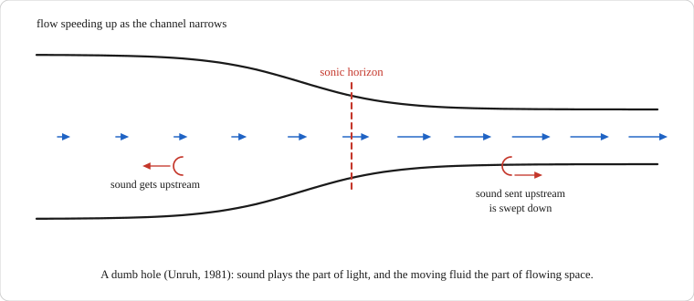
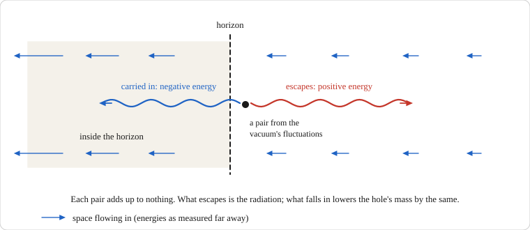

# Hawking and Unruh Radiation

In 1974 Stephen Hawking showed that black holes are not quite black. Once quantum fields are taken into account, a
black hole glows like a warm body, at a temperature that is higher the smaller the hole is. Seven years later, William
Unruh showed that a fluid flowing faster than sound should glow in the same way, with sound in place of light.

Flowing space puts the two side by side. The temperature of the glow is set by one feature of the flow at the horizon:
how fast it speeds up there. This part shows that feature in the flow model, and what it does to light.

!!! note "Reader's note"
    The radiation itself is quantum mechanics, which the flow model doesn't include. What the model shows is the
    classical setting the radiation comes from: flowing space, its horizon, and what it does to light sent out from
    near it. The step from there to the radiation is Hawking's and Unruh's.

## A fluid that traps sound

Unruh's idea, published in 1981, was a *dumb hole*. Let a fluid flow through a channel that narrows, so that it
speeds up as it goes. Where it starts to flow faster than sound travels through it, there is a *sonic horizon*: sound
sent upstream from beyond it is swept downstream, however it is sent, just as light sent outward from inside a black
hole's horizon is carried in.

Unruh showed that such a fluid should give off sound with a thermal spectrum, at a temperature set by how fast the
flow speeds up as it crosses the sonic horizon:

$$
k_B T = \frac{\hbar}{2\pi}\left|\frac{dv}{dx}\right|_\text{horizon}
$$

Experiments with ultracold gases, Bose–Einstein condensates, have since made sonic horizons in the laboratory.
In 2019 Jeff Steinhauer's group reported thermal sound from one, at the temperature this predicts.

## The same in flowing space

Round a black hole, space flows in at $u = c\sqrt{r_s/r}$, reaching the speed of light at the horizon,
$r_s = 2GM/c^2$. That is a sonic horizon, with light in place of sound. How fast the inflow speeds up across it is

$$
\left|\frac{du}{dr}\right|_{r_s} = \frac{c}{2r_s}
$$

exactly. Put it into Unruh's formula and out comes

$$
k_B T = \frac{\hbar c}{4\pi r_s} = \frac{\hbar c^3}{8\pi G M}
$$

which is Hawking's temperature for a black hole, exactly.

## Light peeling off the horizon

Why should how fast the flow speeds up set a temperature? Because of what it does to light sent out from near the
horizon. Light moves out through space at $c$, while space falls in at $u$, so the light gains on the hole at $c - u$.
At the horizon that is zero. Just outside, it is in proportion to the light's distance from the horizon:

$$
\frac{d}{dt}(r - r_s) = c - u \approx \left|\frac{du}{dr}\right|_{r_s}(r - r_s)
$$

So the light's distance from the horizon grows exponentially, by a factor of $e$ every $2r_s/c$. Light sent out from
very close to the horizon lingers there for a long time, then peels away:

The simulation sends light straight out from just outside the horizon of a solar-mass hole, starting from a tenth of
a Schwarzschild radius out down to a millionth, and follows it to three Schwarzschild radii:

<iframe src="../viewer/index.html?player&run=../runs/horizonPeeling/horizonPeeling.full.json" width="100%" height="440" loading="lazy" title="Light peeling off a black hole's horizon"></iframe>

*Each ray's distance from the horizon (on a log scale, in Schwarzschild radii) against time (in $r_s/c$). Near the
horizon they are straight, parallel lines: the distance grows tenfold every 4.6 $r_s/c$. The darkest started closest.*
[Open full screen](../viewer/index.html?run=../runs/horizonPeeling/horizonPeeling.full.json){ target=_blank }

Every ray reaches three Schwarzschild radii when exact general relativity says it should, to 1 part in 10⁸. While it
is within a thousandth of a Schwarzschild radius of the horizon, its distance grows at 0.49997 $c/r_s$ for the ray
that started closest, against the predicted 0.5. The rate the light peels away gives a temperature through Unruh's
formula:

| Black hole | Peeling rate | Temperature from it | Hawking's temperature |
| --- | --- | --- | --- |
| 4 million solar masses (Sagittarius A\*) | 0.0127 per second | 1.542 × 10⁻¹⁴ K | 1.542 × 10⁻¹⁴ K |
| One solar mass | 50,700 per second | 6.167 × 10⁻⁸ K | 6.168 × 10⁻⁸ K |
| 5 × 10¹¹ kg (microscopic) | 2.02 × 10²³ per second | 2.453 × 10¹¹ K | 2.454 × 10¹¹ K |

Any wave sent out from near the horizon is stretched the same way, its wavelength growing exponentially. That is the
heart of Hawking's calculation: the quantum fluctuations of empty space, seen after being stretched like this, look
exactly like the glow of a warm body. The stretching is what the flow model shows; the glow is the quantum step.

## The view from a clock held still

There is a second way to the same temperature. In 1976 Unruh also showed that an observer accelerating through empty
space sees it glowing, at

$$
k_B T = \frac{\hbar a}{2\pi c}
$$

for an acceleration $a$. Empty space, to an observer who isn't in free fall, is warm.

A clock held still just outside the horizon, like [clock 3](../part1/mechanics/four-clocks.md#clock-3-held-still-on-the-surface)
of The Four Clocks, is far from free fall: space rushes past it at nearly the speed of light, and it has to push
enormously hard to stay put. It sees a strong glow. But it is also deep in the hole's potential, where clocks run slow,
so seen from far away its glow is cooled, by the clock's rate $\sqrt{1 - r_s/r}$. The two together leave
$GM/r^2$: in the flow model, the acceleration of space itself, $g$. At the horizon,

$$
k_B T = \frac{\hbar}{2\pi c}\,\frac{GM}{r_s^2} = \frac{\hbar c^3}{8\pi G M}
$$

Hawking's temperature again. The acceleration of space at the horizon and how fast it speeds up there are the same
thing: $g = u\,du/dr$, and at the horizon $u = c$.

## Where the energy comes from

Empty space is never quite still: quantum fields fluctuate, and their fluctuations come in pairs. At a horizon, the
flow separates a pair. One member, just outside, slowly peels away and escapes. Its partner, just inside, is carried
in.

Measured by an observer far away, the escaping member has positive energy and its partner negative energy, which is
possible only where space flows faster than light can travel through it. Each pair adds up to nothing: energy is
conserved. What escapes is the radiation, and what falls in lowers the hole's mass by the same amount. In Unruh's
fluid, the partners slow the flow, and whatever drives the fluid makes it up. A black hole has nothing driving it, so
it loses mass.

As it does, its horizon shrinks, the inflow has to reach the speed of light over a shorter distance, so it speeds up
more steeply there, and the hole gets hotter. A black hole that loses energy heats up, and radiates faster. The
radiation from large holes is far too faint ever to be seen. A small one would end in a final burst:

| Black hole | Schwarzschild radius | Temperature | Power (light only, approximate) |
| --- | --- | --- | --- |
| 4 million solar masses | 1.2 × 10¹⁰ m | 1.5 × 10⁻¹⁴ K | 5.6 × 10⁻⁴² W |
| One solar mass | 2.95 km | 6.2 × 10⁻⁸ K | 9.0 × 10⁻²⁹ W |
| 5 × 10¹¹ kg | 7.4 × 10⁻¹⁶ m | 2.5 × 10¹¹ K | 1.4 × 10⁹ W |

Holes of stellar mass and above are far colder than the 2.7 K of the cosmic microwave background, so for now they
absorb more than they emit.

## What flowing space adds

None of the radiation is new: it is Hawking's and Unruh's. What flowing space adds is a picture in which it is clear
why a black hole and a fluid should behave alike, and where the temperature comes from. A horizon is where the flow
reaches the speed of the waves in it, and the temperature is set by how fast the flow speeds up as it crosses.

*The code: studies/horizon_peeling.py (light peeling off the horizon, against exact general relativity).*
